<p align="center">
  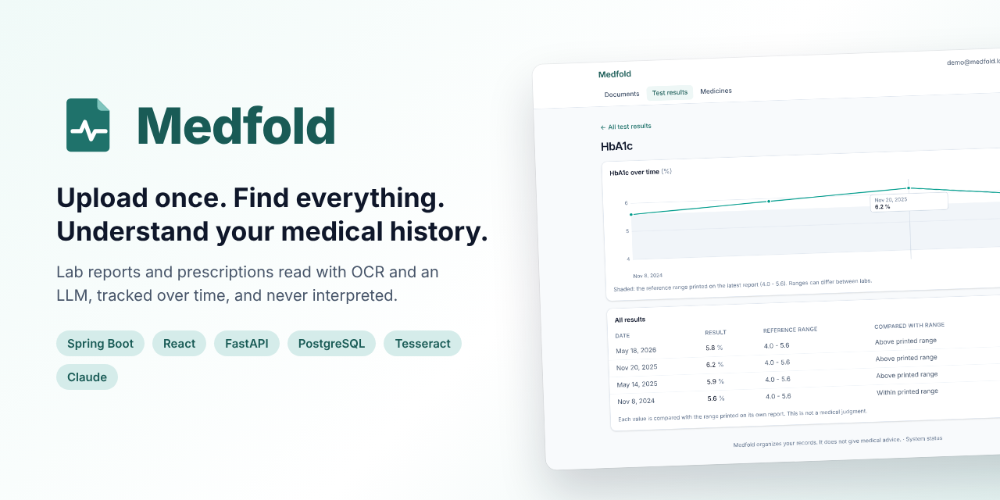
</p>

<p align="center">
  <a href="https://github.com/n3h4a/medfold/actions/workflows/ci.yml"></a>
  <a href="docs/05-testing/test-plan.md#coverage"></a>
  <a href="docs/05-testing/test-plan.md#coverage"></a>
  <a href="docs/05-testing/code-audit.md"></a>
  <a href="LICENSE"></a>
  <br>
  
  
  
  
  
  
  
  
</p>

<p align="center">
  <b>Medfold turns a folder of paper medical reports into a private record you can search,<br>
  follow over time and take to any doctor, without ever telling you what your results mean.</b>
</p>

<p align="center">
  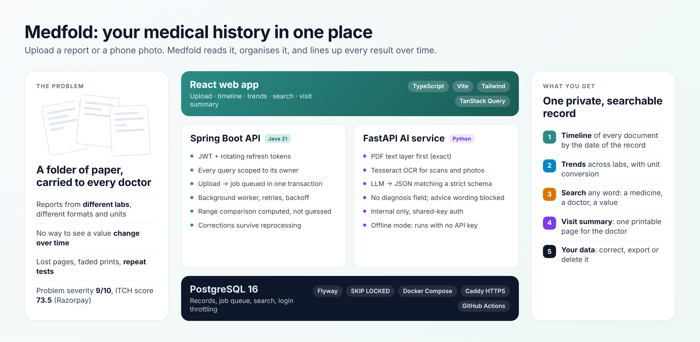
</p>

<p align="center">
  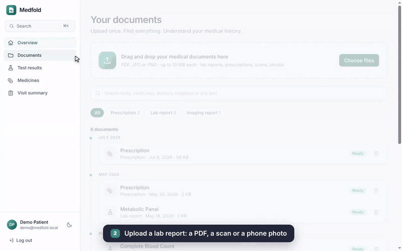
  <br><sub>Upload → read in the background → every value next to the original.
  <b><a href="demo/demo-video.mp4">Watch the full 80-second tour</a></b> (log in → upload → OCR → timeline → search → log out).
  All data shown is synthetic.</sub>
</p>

<p align="center">
  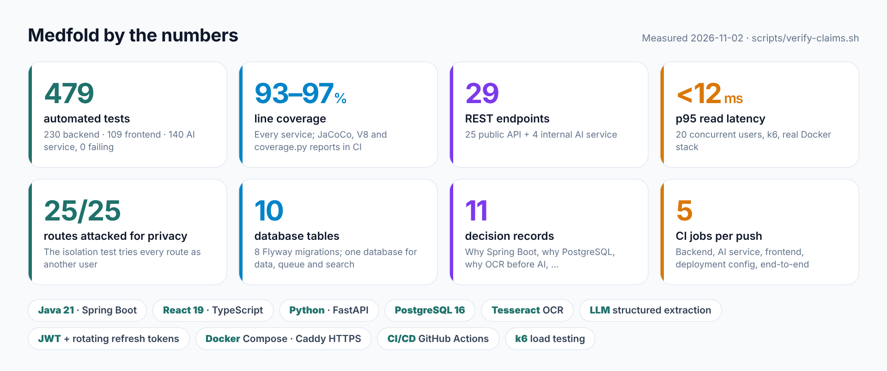
  <br><sub>Every number above is measured, not estimated: <code>scripts/verify-claims.sh</code> re-runs the suites and recounts them.</sub>
</p>

---

## Contents

1. [Why I built this](#why-i-built-this) · [The problem](#the-problem) · [How I thought about it](#how-i-thought-about-it)
2. [What it does](#what-it-does) · [Try it yourself](#try-it-yourself)
3. [How it works](#how-it-works) · [Key decisions](#key-decisions-and-why)
4. [Challenges](#challenges) · [What went wrong](#what-went-wrong) · [Lessons learned](#lessons-learned)
5. [Quality and evidence](#quality-and-evidence) · [Pros and cons](#pros-and-cons)
6. [Status](#status-and-roadmap) · [Project structure](#project-structure) · [API](#api) · [Deployment](#deployment)

---

## Why I built this

I wanted a project that would make me deal with the parts of software that tutorials skip:
data that has to stay private, inputs that are messy and unreliable, work that is too slow to do
inside a web request, and an AI model that will sometimes be wrong. A to-do app doesn't teach any
of that. Medical records teach all of it at once.

I found the problem in a list of startup problem statements published by **Razorpay**, where it
had one of the highest scores. And it's familiar: almost every family keeps a folder like this,
and it's never with you when a doctor asks "what was your last result?"

## The problem

> **Why can't patients access digital copies of medical records?**
>
> Healthcare consumers visiting multiple doctors and specialists must carry physical folders of
> paper reports, X-ray films, and prescription histories because most hospitals don't provide
> patients with digital copies of their own medical data, test results, and imaging studies in
> portable formats.
>
> <sub>Razorpay, HealthTech problem statement</sub>

<p align="center">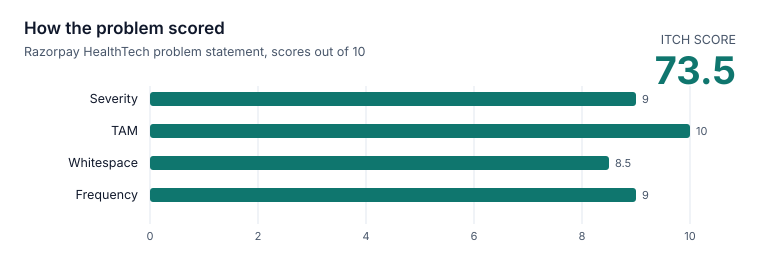</p>

| Score | In plain words | Value |
|---|---|---|
| Severity | How much it hurts when it happens | 9 / 10 |
| TAM | How many people have it (total addressable market) | 10 / 10 |
| Whitespace | How little exists that solves it | 8.5 / 10 |
| Frequency | How often it happens | 9 / 10 |
| **Itch score** | Razorpay's combined score of how much a problem "itches" | **73.5** |

What that looks like in real life:

- **The folder.** Years of reports in a bag, carried to every appointment, or forgotten at home.
- **Repeated tests.** A new doctor can't see last year's results, so the test is done again.
- **Every lab speaks differently.** "HbA1c" or "Glycated Haemoglobin", mg/dL or mmol/L, ranges
  printed five different ways. Results from two labs never line up.
- **No view over time.** "Is my sugar going up?" means spreading five reports on a table.
- **Nothing is findable.** "Which medicine was I given in March?" means reading every page.

## How I thought about it

The problem, as written, is about hospitals: *they* don't hand out digital records. I can't fix
hospital IT, and patients can't wait for someone else to.

So I flipped the question: **what do patients already have?** The paper and the PDFs. Every
report they were ever given is already in their hands, just not in a useful form. If those could
become structured, searchable data, patients would own a digital copy of their records without
any hospital changing anything.

Four rules came out of that, and every later decision follows them:

1. **Start from what people have.** Any PDF or phone photo, from any lab, with no typing.
2. **Describe, never diagnose.** Software that tells someone their result is "bad" can do real
   harm. Medfold copies values exactly and only compares them with the range printed on the same
   report. It never gives advice.
3. **Always show the source.** AI makes mistakes, so the original sits next to everything read
   from it, and anything can be corrected.
4. **The data belongs to the patient.** Private by construction, exportable, deletable.

## What it does

| Overview: what changed, what's worth asking about | Visit summary: one page for the doctor |
|---|---|
| 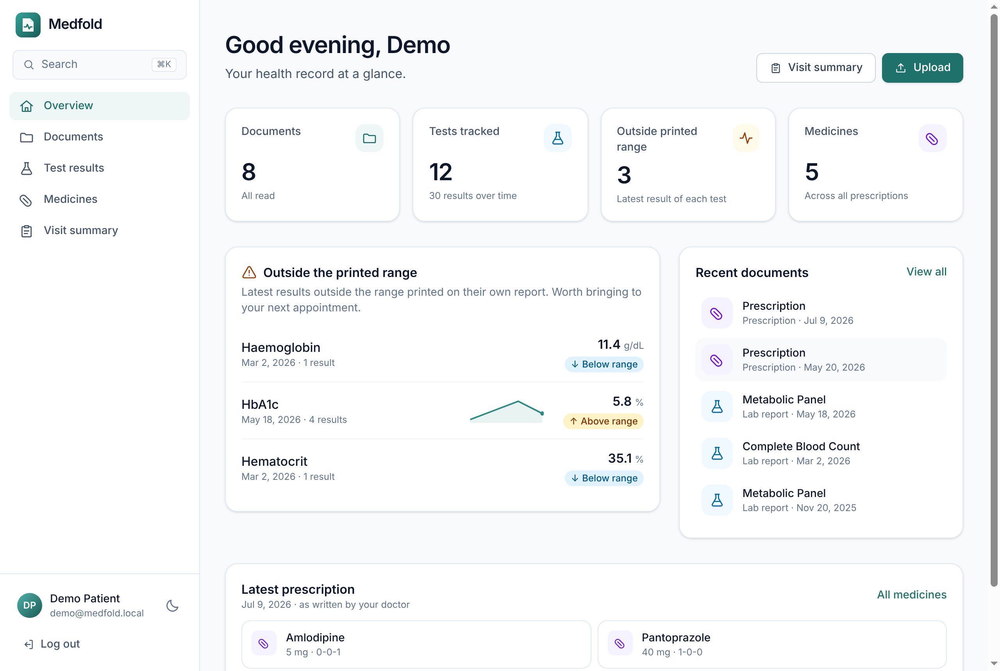 | 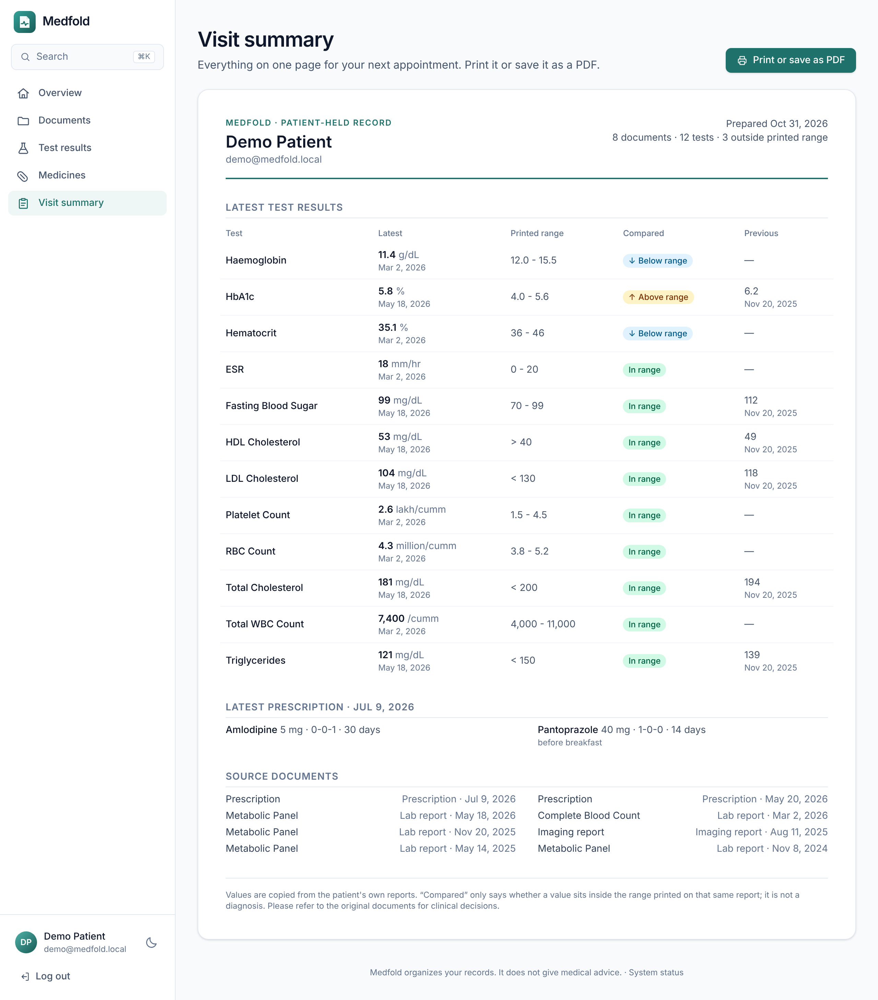 |
| **Timeline: by the date of the record, filter by type** | **One document: the original next to what was read** |
| 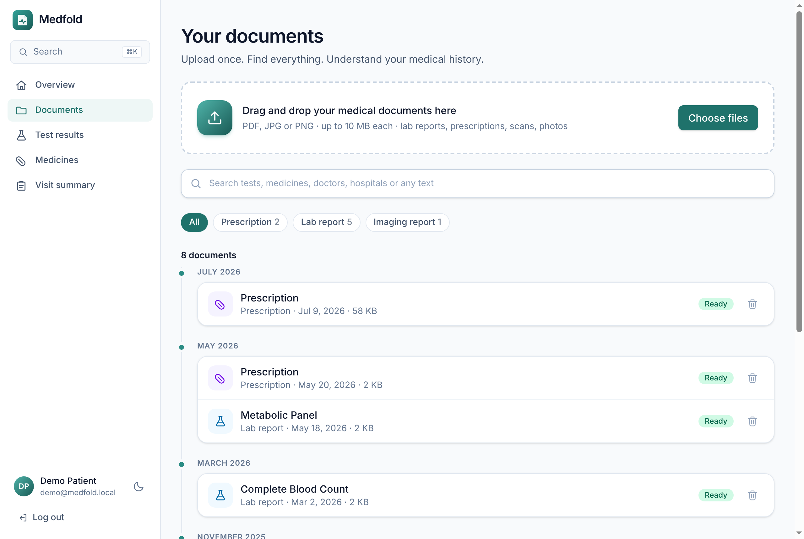 | 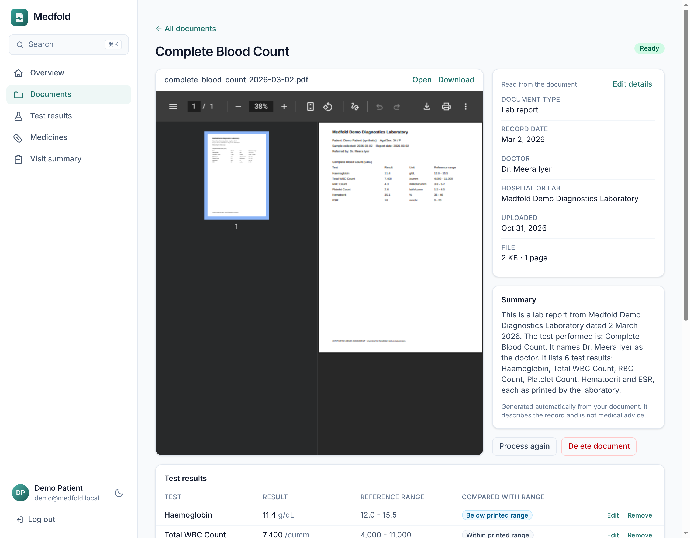 |
| **One test across two years of reports** | **Search anything, from anywhere (Ctrl/⌘ K)** |
| 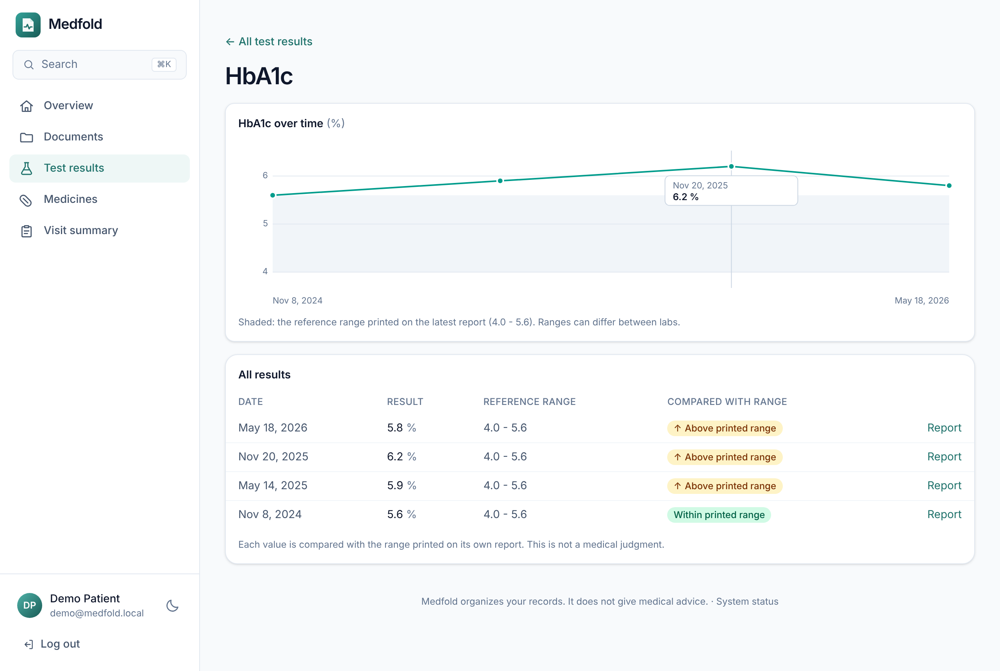 | 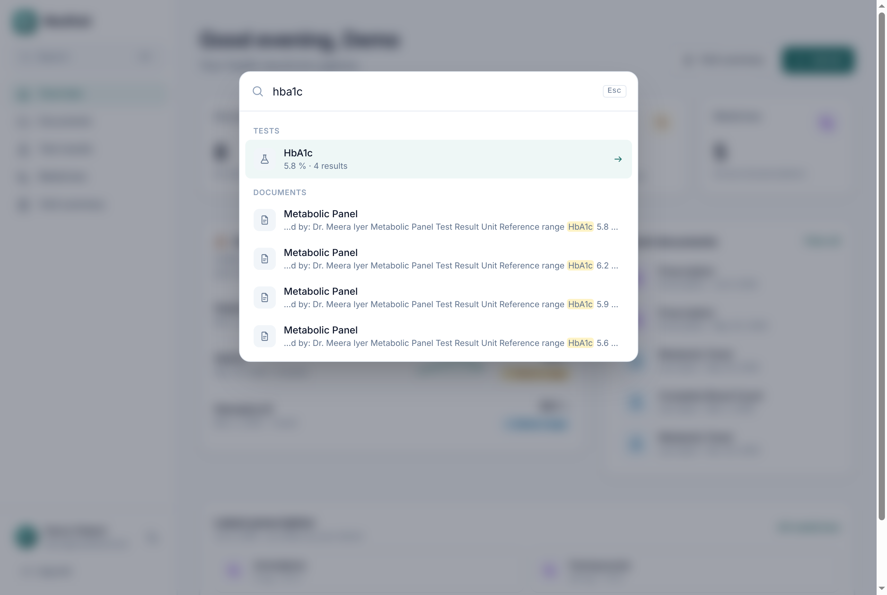 |

<details>
<summary>More screens: test results, medicines, dark mode, phone, login</summary>

| Every test, latest and previous value | Every medicine | Dark mode |
|---|---|---|
| 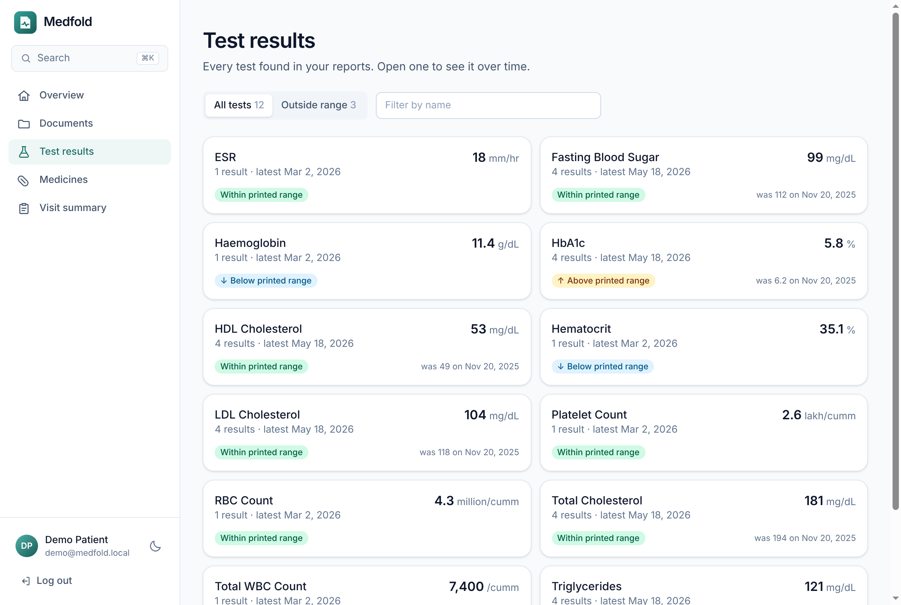 | 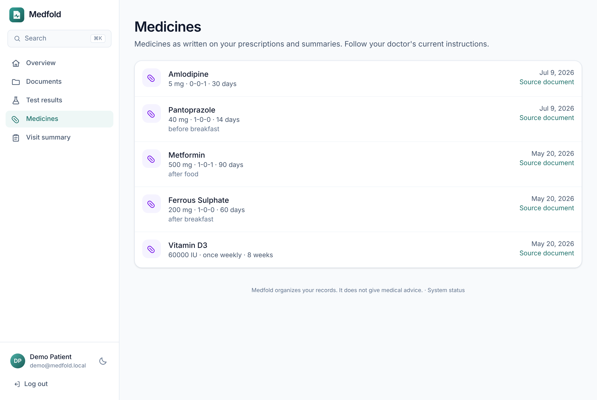 | 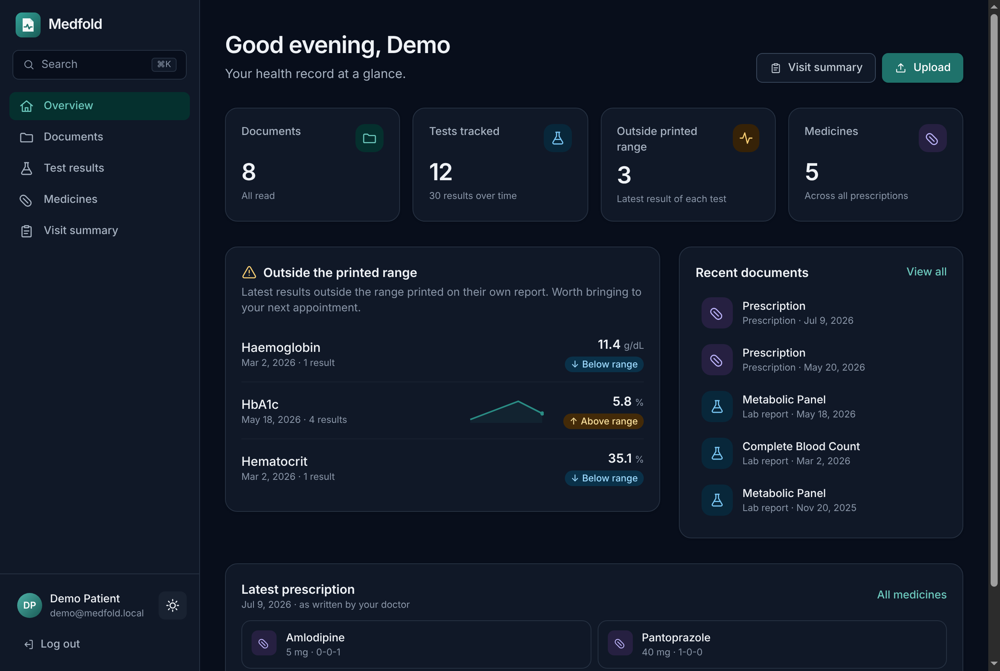 |
| **On a phone** | **Trend on a phone** | **Log in** |
| 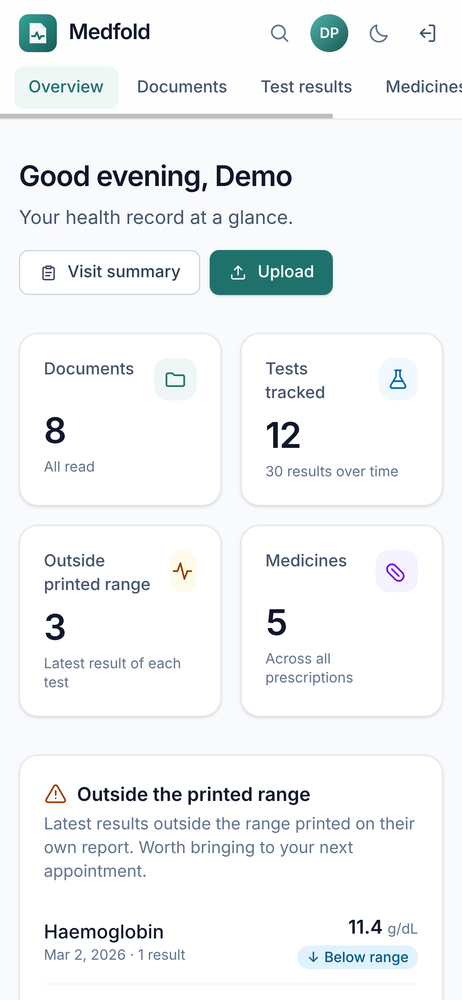 | 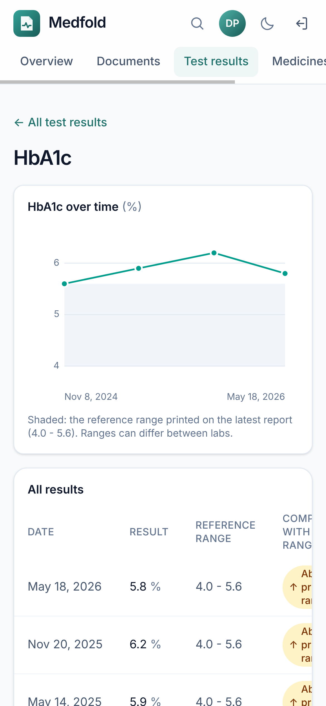 | 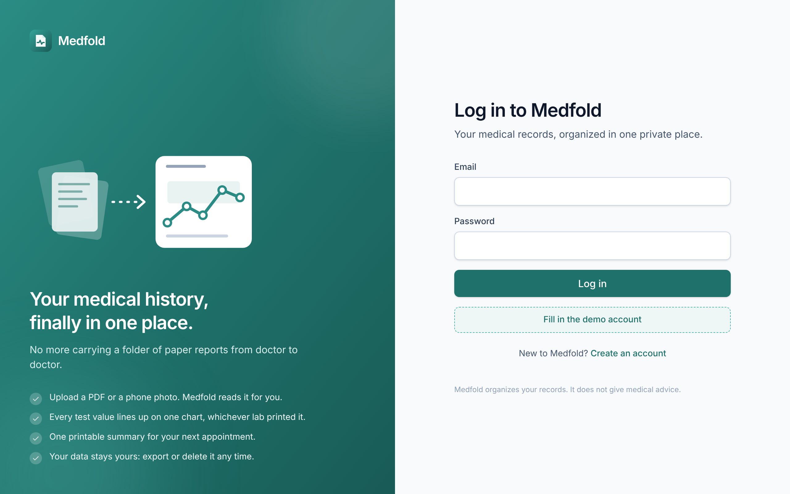 |

</details>

Everything Medfold does, how finished each part is and which tests prove it:
**[FEATURE_MATRIX.md](FEATURE_MATRIX.md)**.

## Try it yourself

**In the browser, nothing to install:** on GitHub choose **Code → Codespaces → Create codespace on
main**. It builds the app, loads a synthetic demo account and opens it; click "Fill in the demo
account" on the login page.

**On your machine** (Docker with Compose):

```bash
git clone https://github.com/n3h4a/medfold.git
cd medfold
cp .env.example .env
docker compose up -d --build
API_URL=http://localhost:3000/api/v1 scripts/seed-demo-data.sh
```

Open http://localhost:3000 and log in as `demo@medfold.local` / `medfold-demo-2026`.

**For development** with hot reload (JDK 21, Node 20+, Python 3.12+):

```bash
scripts/start-dev.sh          # http://localhost:5173 · stop with scripts/stop-dev.sh
scripts/seed-demo-data.sh
```

No API key is needed: an offline reader is the default. To use Claude, set
`LLM_PROVIDER=anthropic` and `LLM_API_KEY` in `.env` ([all settings](docs/06-deployment/environment-variables.md)).

## How it works

<p align="center">
  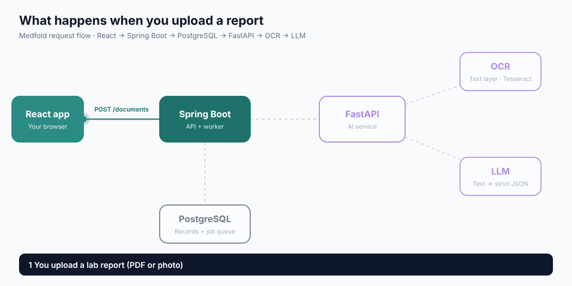
</p>

Three services and one database:

- **React** single-page app (TypeScript, Vite, Tailwind, TanStack Query).
- **Spring Boot** API (Java 21). The only public backend: authentication, ownership rules, the job
  queue, the range comparison. It owns all data.
- **FastAPI** AI service (Python), internal only: PDF text layers, Tesseract OCR, and an LLM that
  fills a strict schema.
- **PostgreSQL** holds the records, the job queue, search and login throttling.

1. **Upload.** The file type is read from the bytes, the file streams to storage with a SHA-256
   hash, and the document and its processing job are saved in **one transaction**. About 16 ms.
2. **Queue.** A worker claims jobs with `FOR UPDATE SKIP LOCKED`, so workers never collide. Failures
   retry with backoff; jobs from a crashed worker are recovered.
3. **Read.** Digital PDFs are read exactly from their text layer; scans and photos go through OCR.
4. **Extract.** The LLM turns page text into JSON matching a schema that has no field for
   diagnosis or advice. The output is validated and every run is audited.
5. **Compare.** The backend, not the AI, compares each value with the range printed on that report.
6. **Show.** The timeline, trends, search and visit summary update.


More: [architecture](docs/03-design/architecture.md) · [components and state machines](docs/03-design/component-design.md) ·
[sequence diagrams](docs/03-design/sequence-diagrams.md) · [database](database/README.md) ·
[security](docs/03-design/security-design.md) · [OCR and extraction pipeline](assets/diagrams/ai-pipeline.svg)

## Key decisions and why

Each one is an [Architecture Decision Record](docs/03-design/adr/README.md) with the alternatives
I turned down and what the choice costs.

| Question | Answer |
|---|---|
| **Why Spring Boot?** ([ADR-008](docs/03-design/adr/ADR-008-why-spring-boot.md)) | The public API is where mistakes cost most. Spring gives tested JWT auth, precise transactions and repositories that can't load another user's data. The price: a heavier runtime than Node or Go. |
| **Why PostgreSQL, and only PostgreSQL?** ([ADR-009](docs/03-design/adr/ADR-009-why-postgresql.md)) | One database also runs the job queue (`SKIP LOCKED`), search and login throttling, so an upload and its job are saved atomically and there's one thing to back up. Search is simple substring matching as a result. |
| **Why OCR before AI?** ([ADR-010](docs/03-design/adr/ADR-010-ocr-before-ai.md)) | Digital PDFs already contain exact text, so there's nothing for a vision model to improve. The model reads stored text, which makes every value traceable and lets the app run offline. Handwriting reads poorly as a result. |
| **How do you stop the AI giving medical advice?** ([ADR-007](docs/03-design/adr/ADR-007-ai-safety-boundary.md)) | Give it nowhere to put advice: the schema has no such field, the wording is checked, and "above range" is arithmetic in the backend. |
| **Why two services?** ([ADR-005](docs/03-design/adr/ADR-005-service-split.md)) | Python has the best OCR and LLM tools, Java the strongest core. The AI service is stateless and can be replaced. |
| **How do sessions work?** ([ADR-001](docs/03-design/adr/ADR-001-authentication.md)) | 15-minute access tokens plus a rotating HttpOnly cookie. A stolen cookie is detected the moment it's reused. |

## Challenges

The parts that were genuinely hard:

- **Letting an AI read medical data without letting it give opinions.** Prompting "please don't
  give advice" isn't a guarantee. The fix was structural: a schema with no field for it, a wording
  check on summaries, and the one evaluative thing (above or below range) computed in Java from
  the numbers on the page.
- **Labs that disagree about everything.** The same test is "HbA1c" on one report and "Glycated
  Haemoglobin" on another, in % here and mmol/mol there, with ranges like `4.0 - 5.6`, `< 200`
  or `M: 13-17, F: 12-15`. Tests get canonical keys, units are converted only where the conversion
  is standard, and a range that can't be parsed with certainty gives no comparison rather than a
  guess.
- **Privacy that can't be forgotten.** "Remember to check the owner" fails eventually. The
  repositories don't contain a query that can load someone else's row, and a test reads the API's
  route table and attacks every endpoint as a second user, so a new endpoint can't be added
  without being checked.
- **Slow AI in a fast app.** OCR plus an LLM call can take minutes. Uploads return immediately; a
  PostgreSQL job queue does the work in the background without holding a transaction open, and
  survives crashes and AI outages.
- **Proving it works, not just saying it.** Writing "93% coverage" is easy. Making that number
  re-measurable with one command, and attacking the running app from outside, took real work.

## What went wrong

Real mistakes, all fixed, each with a test that now guards it ([full bug log](docs/05-testing/bug-log.md)):

- **Every test passed and every document failed.** Java's HTTP client speaks HTTP/2 by default
  and sends an upgrade header; the Python server rejected every upload with 400. The test doubles
  didn't care, so CI was green. I only found it by running the real stack. Since then, CI runs the
  whole Docker stack end to end on every push.
- **A concurrency bug I'd never have seen in a demo.** With two backend instances, a slow job could
  be "recovered" by the second instance while the first was still working on it. The first then
  marked the second's work as done, and the second crashed its worker loop. Found by reading the
  code during an audit; fixed with a row lock and an ownership check
  ([code audit](docs/05-testing/code-audit.md)).
- **I quoted a number measured on the wrong machine.** The README said the AI service had 92.6%
  coverage. It was measured without Tesseract installed, so 7 tests were skipped; CI actually
  measures 97.1%. Wrong in the flattering direction or not, it was wrong, and it's why
  `scripts/verify-claims.sh` exists.
- **Login protection that reset itself.** The first version counted failed logins in memory, so a
  restart wiped the count and two servers never shared it. It now lives in PostgreSQL.
- **A corrected medicine that came back twice.** If you renamed a misread medicine and reprocessed
  the document, the original reading reappeared next to your correction. Corrections are now
  matched on the name as first read.
- **Demo data that duplicated itself.** Regenerating the sample PDFs changed their bytes (an
  embedded timestamp), so the duplicate check saw new files. The generator is now byte-for-byte
  deterministic.
- **The first UI worked but looked like an admin panel.** Version 1.1 redesigned it around the
  questions people actually ask: what changed, what should I ask my doctor, where is that report.

## Lessons learned

- **Reframing beats brute force.** The problem as written was about hospitals. The problem I could
  solve was about the paper patients already hold.
- **"Tests pass" is not "it works".** The worst bug lived in the gap between test doubles and the
  real services. Run the real thing as early and as often as you can.
- **Safety is a design property, not a prompt.** Removing the place where a model could write
  advice works better than asking it nicely.
- **Make the right thing the only thing.** Privacy holds because unsafe queries don't exist in the
  code, not because everyone remembers to be careful.
- **A number in a README is a promise.** If it can't be reproduced with one command, it shouldn't
  be there.
- **Write decisions down while they're fresh.** The ADRs record what I rejected and why. Months
  later that's the part I'd otherwise have forgotten.

## Quality and evidence

| | |
|---|---|
| **Tests** | 471: 223 backend (against a real PostgreSQL), 108 frontend, 140 AI service, plus an end-to-end CI job on the built Docker stack that OCRs a photographed prescription |
| **Coverage** | Lines: backend 93.3%, frontend 94.7%, AI service 97.1% ([test plan](docs/05-testing/test-plan.md)) |
| **Reproducible** | `scripts/verify-claims.sh` re-runs every suite and recounts every number on this page |
| **Privacy** | `UserIsolationTest` attacks all 25 routes as a second user; new routes fail the build until they're checked |
| **Security** | `scripts/security-check.sh` attacks a running stack from outside: 22/22 pass; no known vulnerable dependencies ([code audit](docs/05-testing/code-audit.md)) |
| **Performance** | k6, 20 concurrent users: 8,295 requests, 0 failed, p95 6.5–11 ms for reads ([load test](docs/05-testing/performance-testing.md)) |
| **Traceability** | Every use case's acceptance criteria name the tests that verify them ([use cases](docs/02-product/use-cases.md)) |

<p>
  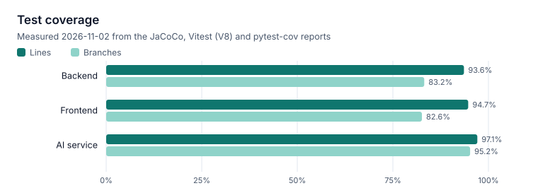
  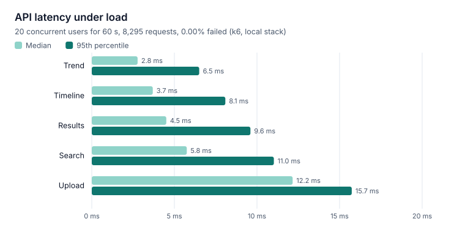
</p>

## Pros and cons

| Strengths | Trade-offs |
|---|---|
| Works with documents people already have, from any lab, with no hospital integration | Only as complete as what the user uploads; nothing arrives automatically |
| No typing: reports become structured data | OCR can misread blurry photos or handwriting, so values may need correcting |
| Values copied exactly; the original always alongside | Results with unclear ranges (e.g. sex-specific) get no comparison |
| Never interprets or advises, so it can't mislead | It won't say "this trend is worrying": a deliberate limit |
| Lines up tests across labs, names and units | Unit conversion covers common tests only |
| Private by design: strict isolation, export, full deletion | Using Claude sends page text to Anthropic; the offline reader keeps it local but reads less |
| One server, one command, no cloud services required | Scaling out needs object storage (on the roadmap) |

All limitations: [KNOWN_LIMITATIONS.md](KNOWN_LIMITATIONS.md).

## Status and roadmap

**v1.1.0**: feature-complete for one person's records, CI green. Done, in progress, remaining
and known issues: **[PROJECT_STATUS.md](PROJECT_STATUS.md)**.

Next: password reset and two-factor login, typo-tolerant search, more OCR languages, a vision
model only for hard-to-read pages, sharing a read-only link with a doctor, FHIR export
([ROADMAP.md](ROADMAP.md), [issues](https://github.com/n3h4a/medfold/issues)).

## Project structure

```
medfold/
├── frontend/      React SPA                         ├── docs/       00-project … 09-appendix
├── backend/       Spring Boot API                   ├── scripts/    start-dev, seed, verify-claims, security-check, backup
├── ai-service/    FastAPI OCR and extraction        ├── tests/      sample documents, load test
├── database/      ER diagram, schema, migrations    ├── postman/    API collection
├── docker/        production overlay, Caddy         ├── demo/       video, GIF, screenshots, narration
├── .devcontainer/ Codespaces demo                   ├── assets/     overview, diagrams, charts (all generated)
└── .github/       CI, issue and PR templates
```

Annotated: [folder structure](docs/04-development/folder-structure.md). All documentation:
[docs/](docs/README.md).

## API

REST + JSON under `/api/v1`, with short-lived JWTs and a rotating refresh cookie.

| | |
|---|---|
| `POST /auth/register`, `/auth/login`, `/auth/refresh`, `/auth/logout` | Sessions |
| `POST /documents` · `GET /documents` · `GET /documents/{id}/results` | Upload, timeline, extracted results |
| `PATCH /documents/{id}`, `/lab-results/{id}`, `/medications/{id}` | Corrections |
| `GET /labs` · `GET /labs/{testKey}` · `GET /search?q=` · `GET /medications` | Tests, trends, search, medicines |
| `GET /account/export` · `DELETE /account` | Take your data, or leave |

All 25 endpoints with errors and examples: [API design](docs/03-design/api-design.md). Runnable:
[Postman collection](postman/README.md).

## Deployment

`docker/docker-compose.prod.yml` adds Caddy for automatic HTTPS, closes every internal port and
refuses to start without real secrets; `scripts/backup.sh` and `scripts/restore.sh` handle
backups. Guide: [production deployment](docs/06-deployment/deployment-guide.md) (including a
[public demo](docs/06-deployment/deployment-guide.md#a-public-demo)) ·
[checklist](docs/06-deployment/production-checklist.md) · [rollback plan](docs/06-deployment/rollback-plan.md).

## Contributing

Contributions are welcome: see [CONTRIBUTING.md](CONTRIBUTING.md) and the
[code of conduct](CODE_OF_CONDUCT.md). Security issues: [SECURITY.md](SECURITY.md).

## License

[MIT](LICENSE)

## Author

Built by [n3h4a](https://github.com/n3h4a).

> Medfold organises records; it is not a medical device and does not give medical advice.
> Every document in this repository and its screenshots is synthetic.
