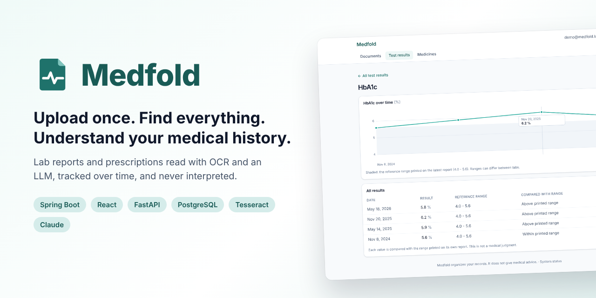
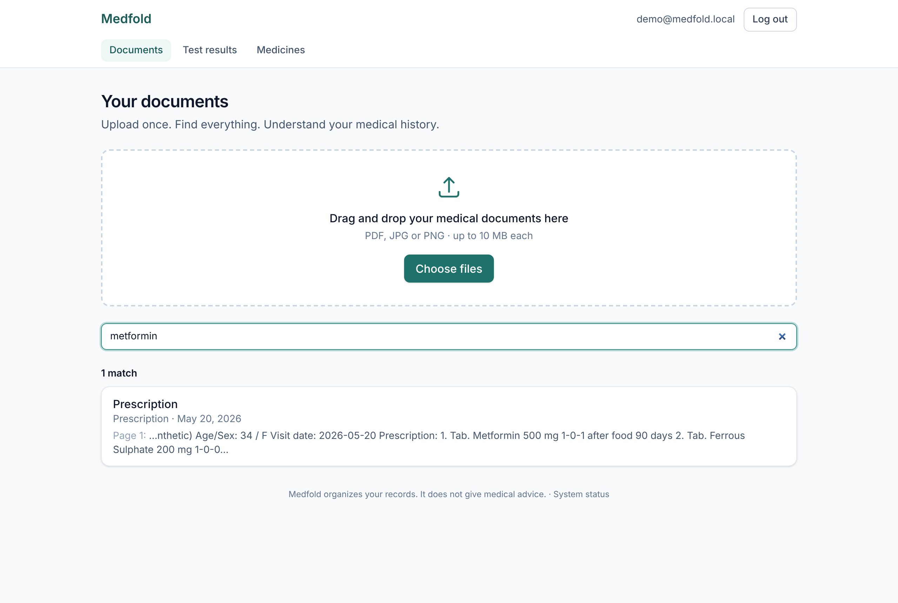
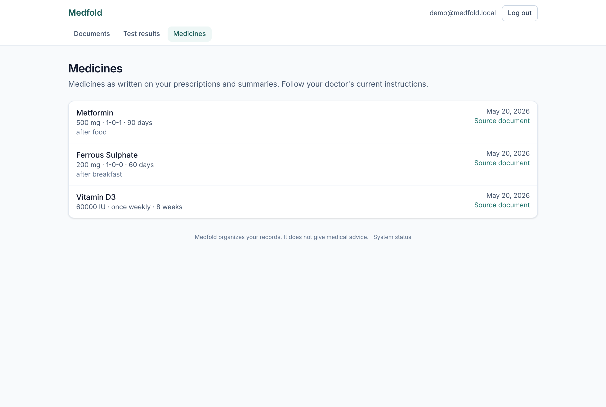
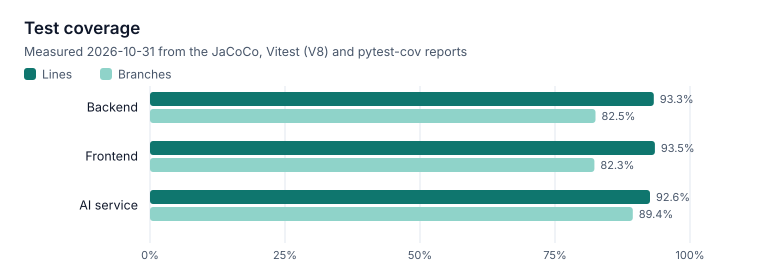

<p align="center">
  
</p>

<p align="center">
  <a href="https://github.com/n3h4a/medfold/actions/workflows/ci.yml"></a>
  <a href="docs/05-testing/test-plan.md#coverage"></a>
  <a href="docs/05-testing/performance-testing.md"></a>
  <a href="LICENSE"></a>
  <br>
  
  
  
  
  
  
  
  
</p>

<p align="center">
  <b>Medfold turns a pile of medical paperwork into a personal health record you can search,<br>
  compare over time and carry anywhere, without ever telling you what your results mean.</b>
</p>

<p align="center">
  
  <br><sub>Upload → read automatically → results compared with the printed range → trends → search
  (<a href="demo/demo-video.mp4">video</a>). Every document shown is synthetic.</sub>
</p>

---

## At a glance

| | |
|---|---|
| **The problem** | Patients carry folders of paper reports between doctors because hospitals rarely give them their own records in digital form ([Razorpay HealthTech problem](#where-the-problem-came-from), itch score **73.5**) |
| **The idea** | Instead of waiting for hospitals to change, start from the paper and PDFs patients already have and make them digital, searchable and comparable |
| **What it does** | Reads uploaded reports and photos (OCR + an LLM), files them on a timeline, tracks each test across labs, finds anything by any word |
| **What it never does** | Diagnose, judge or advise. It describes documents; the original is always one click away |
| **Built with** | React + TypeScript · Spring Boot (Java 21) · FastAPI (Python) · PostgreSQL · Docker |
| **Evidence** | 457 automated tests, 93% line coverage, end-to-end CI on the real Docker stack, p95 reads under 12 ms at 20 concurrent users, a privacy test that attacks every endpoint |

## Contents

1. [The story](#the-story): the problem, why it hurts, how I thought about it, the solution
2. [See it work](#see-it-work)
3. [Pros and cons](#pros-and-cons)
4. [Key decisions and why](#key-decisions-and-why)
5. [How it works](#how-it-works) (for engineers)
6. [Quality and evidence](#quality-and-evidence)
7. [Try it yourself](#try-it-yourself)
8. [Project structure](#project-structure) · [API](#api) · [Deployment](#deployment)
9. [Limitations](#limitations) · [Roadmap](#roadmap) · [What I learned](#what-i-learned)

---

## The story

### Where the problem came from

The problem comes from a HealthTech problem statement published by **Razorpay**:

> **Why can't patients access digital copies of medical records?**
>
> Healthcare consumers visiting multiple doctors and specialists must carry physical folders of
> paper reports, X-ray films, and prescription histories because most hospitals don't provide
> patients with digital copies of their own medical data, test results, and imaging studies in
> portable formats.

Razorpay scored it on four dimensions, combined into an **itch score of 73.5**:

<p align="center"></p>

In plain words:

| Score | What it measures | Value |
|---|---|---|
| **Severity** | How much the problem hurts the people who have it | 9 / 10 |
| **TAM** (total addressable market) | How many people could use a solution | 10 / 10 |
| **Whitespace** | How little existing products already solve it | 8.5 / 10 |
| **Frequency** | How often people run into it | 9 / 10 |
| **Itch score** | Razorpay's combined rating of how much a problem "itches" | **73.5** |

High on every axis: almost everyone sees doctors, it happens again and again, it matters when it
happens, and little exists that fixes it.

### Why it hurts

Think about anyone managing a long-term condition, or a parent looking after an elderly relative:

- 📁 **The folder.** Years of reports in a bag, carried to every appointment, or forgotten at home.
- 🔁 **Repeated tests.** A new doctor can't see last year's results, so tests are done again.
- 🧩 **Every lab is different.** Each prints names, units and ranges its own way ("HbA1c",
  "Glycated Haemoglobin"; "mg/dL", "mmol/L"), so results never line up.
- 📉 **No view over time.** "Is my sugar going up?" means laying five reports on a table.
- 🔍 **Nothing is findable.** "Which medicine was I given in March?" means reading every page.
- 🚑 **When it matters most,** in an emergency or with a new specialist, the history isn't there.

### How I thought about it

The problem as stated is about hospitals: *they* don't hand out digital records. Fixing that means
hospital IT systems, integrations and regulation; a student project can't change that, and patients
can't wait for it.

So I asked a different question: **what do patients already have?** They have the paper and the
PDFs. Every report, prescription and discharge summary they were ever given is already in their
hands, just not in a useful form. If those could become structured, searchable, comparable data,
the patient would own a digital copy of their records **without needing any hospital to change**.

That reframing led to four principles, which shaped every later decision:

1. **Work from what people have.** Any PDF or phone photo, from any lab, with no typing.
2. **Describe, never diagnose.** Software that tells someone their result is "bad" can cause real
   harm. Medfold copies values exactly as printed and only compares them with the range printed on
   the same report. It never gives advice.
3. **Always show the source.** AI makes mistakes; the original document sits next to everything
   extracted from it, and anything can be corrected.
4. **The data belongs to the patient.** Private by construction, exportable in one click,
   deletable completely.

### The solution, in plain words

Imagine a careful assistant who takes your folder of medical papers and:

1. **reads** every page, even photos taken on a phone;
2. **files** each one by the date it was written, not the date you found it;
3. **writes down** every test result exactly as printed, and notes whether it sits below, within
   or above the range *that same report* printed;
4. **lines up** the same test across different labs, even when they use different names or units,
   so you can see it change over time;
5. **finds** anything you ask for: a medicine, a doctor, a word on page three;
6. and **never** tells you what any of it means for your health. That's your doctor's job.

That assistant is Medfold.

---

## See it work

| Your documents, by month | One document: original next to what was read |
|---|---|
|  |  |
| **One test across two years of reports** | **Find anything** |
|  |  |

<details>
<summary>More screens: all test results, medicines, phone</summary>

| Every test, latest value | Every medicine | On a phone |
|---|---|---|
|  |  |  |

</details>

**A typical use:** drop a stack of reports onto the page → watch each one get read in a couple of
seconds → open a blood count and see haemoglobin marked "below printed range" next to the original
PDF → click HbA1c to see it across two years (a value a lab printed in another unit is converted
and labelled) → before an appointment, search "metformin" to find when it was prescribed.

## Pros and cons

An honest look at the approach.

| ✅ Strengths | ⚠️ Trade-offs |
|---|---|
| Works with documents people already have, from any lab, with no hospital integration | Only as complete as what the user uploads; nothing arrives automatically |
| No typing: reports become structured data automatically | OCR can misread blurry photos or handwriting, so values may need correcting |
| Values copied exactly; the original is always shown alongside | Some results get no comparison when the range is unclear (e.g. sex-specific) |
| Never interprets or advises, so it can't mislead with a medical judgment | It won't say "this trend is worrying": a deliberate limit |
| Lines up tests across labs, names and units | Unit conversion covers common tests only; others are listed but not charted |
| Private by design: strict per-user isolation, export and full deletion | Using Claude sends page text to Anthropic; the offline reader avoids that but reads less |
| Runs on one server with one command; no cloud services required | Single-server design; scaling out needs object storage (on the roadmap) |
| Search finds partial words like "metfor" or "hba1" | No typo tolerance or ranking yet |

Full list: [KNOWN_LIMITATIONS.md](KNOWN_LIMITATIONS.md).

## Key decisions and why

Each is written up as an [Architecture Decision Record](docs/03-design/adr/README.md) with the
alternatives I rejected.

| Decision | Why |
|---|---|
| **The AI fills a schema with no field for diagnosis or advice** ([ADR-007](docs/03-design/adr/ADR-007-ai-safety-boundary.md)) | The safest way to stop a model giving medical opinions is to give it nowhere to put one. "Below/above range" is computed by the backend from the report itself |
| **Read the PDF's own text first, OCR only when needed** ([ADR-004](docs/03-design/adr/ADR-004-ocr.md)) | Digital PDFs are read exactly in ~30 ms; OCR is slower and makes mistakes, so it's used only for scans and photos |
| **A separate Python service for AI, Spring Boot for the product** ([ADR-005](docs/03-design/adr/ADR-005-service-split.md)) | Python has the best OCR and LLM tools; Java/Spring has the strongest security, transactions and testing for the core. Each does what it's best at |
| **The job queue is a PostgreSQL table** ([ADR-006](docs/03-design/adr/ADR-006-job-queue.md)) | Saving the upload and its job in one transaction means no lost work and no extra message broker to run |
| **Short-lived tokens plus a rotating cookie** ([ADR-001](docs/03-design/adr/ADR-001-authentication.md)) | A stolen token is useless within 15 minutes, and a stolen refresh cookie is detected the moment it's reused |
| **Search inside PostgreSQL, no search engine** ([ADR-003](docs/03-design/adr/ADR-003-search.md)) | Medical data never leaves the database, and one person's records are small enough for fast substring search |
| **Backend organised by feature** (`document/`, `records/`, `search/`) | Everything about one feature lives together, as Spring recommends, so changes stay local |
| **Each Dockerfile next to its service** | Every service builds, tests and ships on its own; [docker/](docker/README.md) maps them all |

## How it works

*For engineers.* Three services: a **React** single-page app, a **Spring Boot** API that owns all
data and runs a background job queue in **PostgreSQL**, and an internal **FastAPI** service for OCR
and LLM extraction.



1. **Upload.** The file type is checked from its bytes, the file is streamed to storage with a
   SHA-256 hash, and the document and a processing job are saved in **one transaction**. The
   request returns in ~15 ms.
2. **Queue.** A worker claims jobs with `FOR UPDATE SKIP LOCKED`, so several workers never collide.
   Failures retry with backoff; jobs from a crashed worker are recovered.
3. **Read.** The AI service takes each page's text layer, or renders the page and runs Tesseract.
4. **Extract.** An LLM (Claude, or an offline rule-based reader) fills a strict schema. Output is
   validated and its wording safety-checked; every run is audited with model and prompt version.
5. **Compare.** The backend compares each value with the range printed on the same report, only
   when both parse with certainty.
6. **Show.** The browser follows progress and shows the original next to the extracted data.

<details>
<summary>The OCR and extraction pipeline in detail</summary>


</details>

More: [architecture](docs/03-design/architecture.md) · [components and state machines](docs/03-design/component-design.md) ·
[sequence diagrams](docs/03-design/sequence-diagrams.md) · [database](database/README.md) ·
[security](docs/03-design/security-design.md)

### Tech stack

| Layer | Technologies |
|---|---|
| Frontend | React 19, TypeScript, Vite, Tailwind CSS, TanStack Query, React Router, Vitest, Testing Library |
| Backend | Java 21, Spring Boot 4, Spring Security (JWT), Spring Data JPA, Flyway, JUnit 5, Testcontainers, JaCoCo |
| AI service | Python 3.12, FastAPI, Pydantic, pypdf, pypdfium2, Pillow, Tesseract OCR, Anthropic SDK, pytest |
| Data | PostgreSQL 16 |
| Infrastructure | Docker Compose, nginx, Caddy (HTTPS), GitHub Actions, Postman/Newman, k6 |

## Quality and evidence

| | |
|---|---|
| **Tests** | 222 backend (against a real PostgreSQL) · 95 frontend · 140 AI service · end to end on the built Docker stack in CI, including real Tesseract OCR of a photographed-style prescription image |
| **Coverage** | 92.6–93.5% of lines in every service; reports published by CI ([test plan](docs/05-testing/test-plan.md)) |
| **Privacy** | A test reads the API's route table and attacks every endpoint as a second user; a new endpoint can't be added without it |
| **Performance** | 8,295 requests, 0 failed; p95 6.5–11 ms for reads at 20 concurrent users ([load test](docs/05-testing/performance-testing.md)) |
| **Traceability** | Every use case's acceptance criteria name the tests that verify them ([use cases](docs/02-product/use-cases.md)) |
| **Honesty** | 11 real bugs logged with root cause and the test that now guards each ([bug log](docs/05-testing/bug-log.md)) |

<p>
  
  
</p>

## Try it yourself

**Everything in Docker** (needs Docker with Compose):

```bash
git clone https://github.com/n3h4a/medfold.git
cd medfold
cp .env.example .env
docker compose up -d --build
API_URL=http://localhost:3000/api/v1 scripts/seed-demo-data.sh
```

Open http://localhost:3000 and log in as `demo@medfold.local` / `medfold-demo-2026`. The demo
reports are synthetic.

**For development** with hot reload (JDK 21, Node 20+, Python 3.12+):

```bash
scripts/start-dev.sh          # http://localhost:5173 · stop with scripts/stop-dev.sh
scripts/seed-demo-data.sh
```

No API key is needed: the offline reader is the default. For Claude, set `LLM_PROVIDER=anthropic`
and `LLM_API_KEY` in `.env` ([all settings](docs/06-deployment/environment-variables.md)).

## Project structure

```
medfold/
├── frontend/      React SPA                         ├── docs/       00-project … 09-appendix
├── backend/       Spring Boot API                   ├── scripts/    start-dev, seed-demo-data, backup, …
├── ai-service/    FastAPI OCR and extraction        ├── tests/      sample documents, load test
├── database/      ER diagram, schema, migrations    ├── postman/    API collection
├── docker/        production overlay, Caddy         ├── demo/       GIF, video, screenshots
└── .github/       CI, issue and PR templates        └── assets/     logo, diagrams, charts
```

Annotated: [folder structure](docs/04-development/folder-structure.md). All documentation:
[docs/](docs/README.md).

## API

REST + JSON under `/api/v1`, with short-lived JWTs and a rotating refresh cookie.

| | |
|---|---|
| `POST /auth/register`, `/auth/login`, `/auth/refresh` | Sessions |
| `POST /documents` · `GET /documents` · `GET /documents/{id}/results` | Upload, timeline, extracted results |
| `PATCH /documents/{id}`, `/lab-results/{id}`, `/medications/{id}` | Corrections |
| `GET /labs/{testKey}` · `GET /search?q=` · `GET /medications` | Trends, search, medicines |
| `GET /account/export` · `DELETE /account` | Take your data, or leave |

All 25 endpoints with errors and examples: [API design](docs/03-design/api-design.md). Runnable:
[Postman collection](postman/README.md).

## Deployment

`docker/docker-compose.prod.yml` adds Caddy for automatic HTTPS, closes every internal port and
refuses to start without real secrets; `scripts/backup.sh` and `scripts/restore.sh` handle
backups. Guide: [production deployment](docs/06-deployment/deployment-guide.md) ·
[checklist](docs/06-deployment/production-checklist.md) · [rollback plan](docs/06-deployment/rollback-plan.md).

## Limitations

Medfold is a v1.0 built for one person's records. It doesn't connect to hospitals, reads English
best, can misread poor photos (the original is always shown, and values can be corrected), and runs
on a single server. Using Claude sends page text to Anthropic; the offline reader keeps everything
local. Details: [KNOWN_LIMITATIONS.md](KNOWN_LIMITATIONS.md).

## Roadmap

Next: password reset and two-factor login, typo-tolerant search, more OCR languages, sharing a
read-only summary with a doctor, FHIR export, and object storage. See [ROADMAP.md](ROADMAP.md) and
the [issues](https://github.com/n3h4a/medfold/issues).

## What I learned

- **Reframing beats brute force.** The stated problem was about hospitals; the solvable problem was
  about the paper patients already hold.
- **Safety is a design property, not a prompt.** Removing the place a model could write advice
  works better than asking it nicely not to.
- **Run the real thing.** The worst bug (every document failing against the real AI service while
  all tests passed) only appeared when the whole system ran together. That's why CI now runs the
  full Docker stack end to end.
- **Make the right thing the only thing.** Privacy holds because unsafe database queries don't
  exist in the code, and a test fails the build if a new endpoint isn't checked.
- **Write decisions down.** The ADRs record the alternatives as well as the choices, which made
  later changes much easier to reason about.

More in the [implementation notes](docs/04-development/implementation-notes.md).

## Contributing

Contributions are welcome: see [CONTRIBUTING.md](CONTRIBUTING.md) and the
[code of conduct](CODE_OF_CONDUCT.md). Security issues: [SECURITY.md](SECURITY.md).

## License

[MIT](LICENSE)

## Author

Built by [n3h4a](https://github.com/n3h4a).

> Medfold organises records; it is not a medical device and does not give medical advice.
> Every document in this repository and its screenshots is synthetic.
