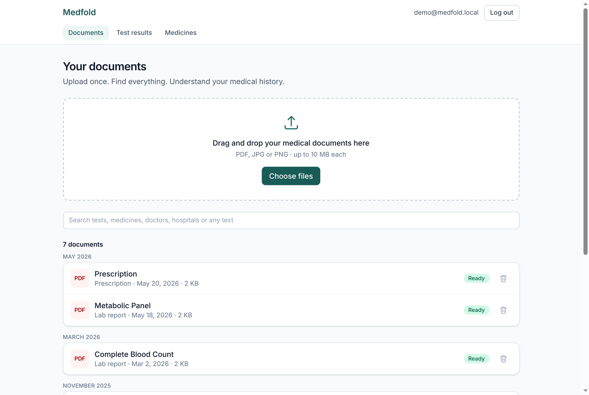
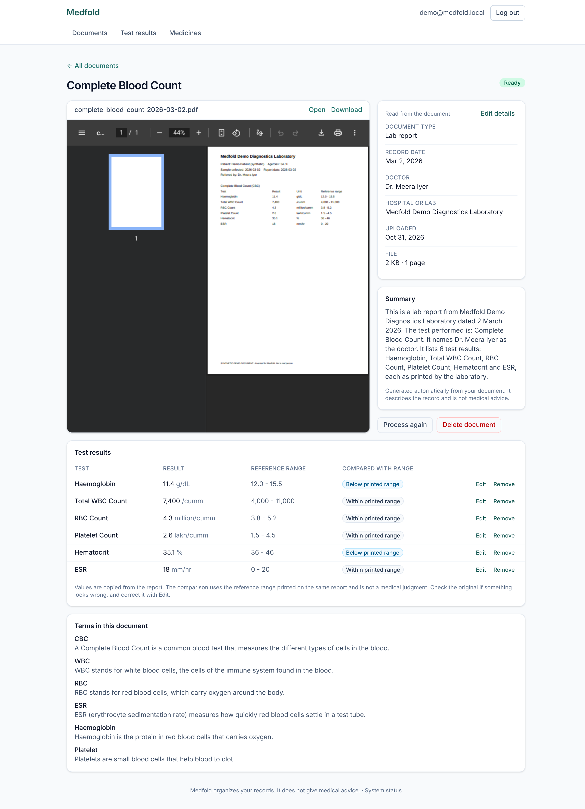
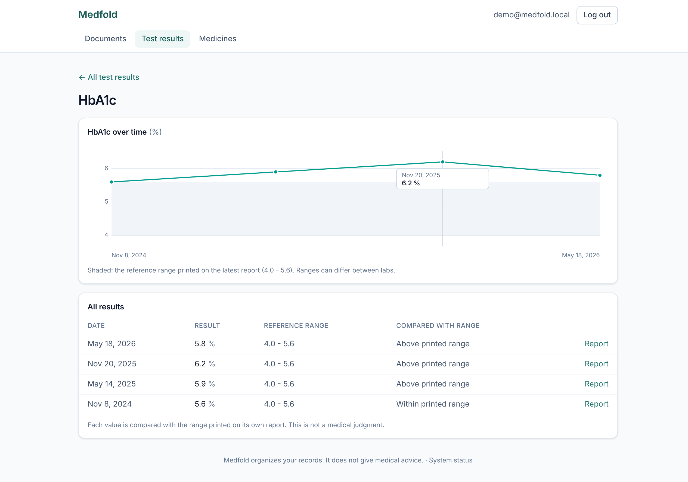
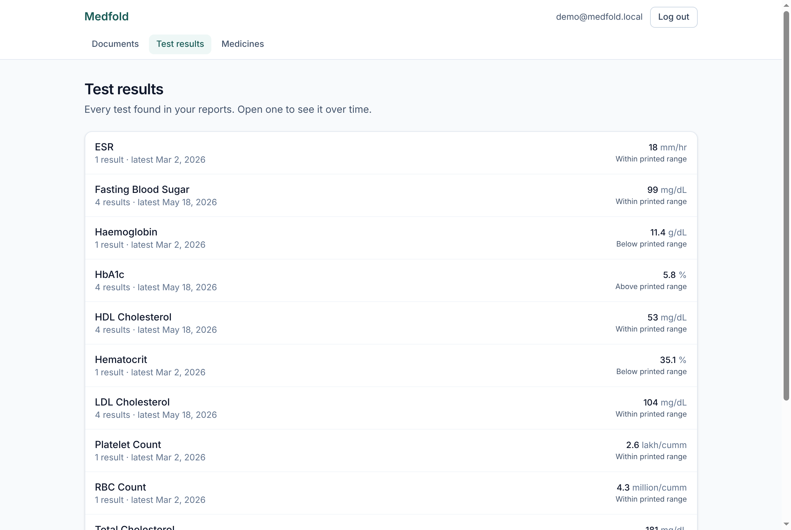
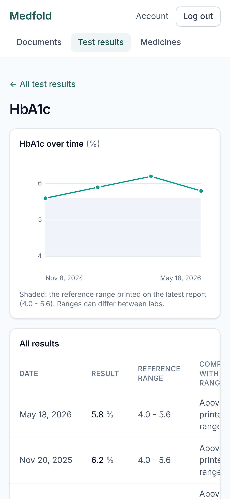
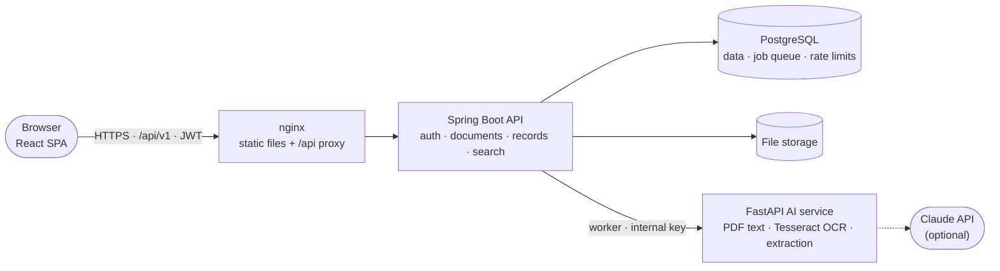

<p align="center">
  
</p>

<p align="center">
  <strong>Upload once. Find everything. Understand your medical history.</strong>
</p>

<p align="center">
  <a href="https://github.com/n3h4a/medfold/actions/workflows/ci.yml"></a>
  <a href="LICENSE"></a>
  
  
  
  
</p>

Medfold is a personal health-records app. You upload lab reports, prescriptions and scans as
PDFs or phone photos; it reads them with OCR and an LLM, and turns years of scattered paperwork
into a searchable timeline with test results tracked over time. It describes what your documents
say and never gives medical advice.

<p align="center">
  
  <br><sub>Upload → read automatically → results compared with the printed range → trends → search
  (<a href="assets/demo/medfold-demo.mp4">MP4</a>). All data shown is synthetic.</sub>
</p>

## Highlights

- **Full document pipeline.** Upload → PostgreSQL job queue → PDF text layer or Tesseract OCR →
  LLM extraction (Claude, or an offline reader) → validated, structured records. Retries,
  crash recovery and no database transaction held during slow AI calls.
- **AI with guardrails.** The model fills a schema that has no field for diagnosis or advice;
  values are copied as printed, and "below/above range" is computed by the backend from the
  report's own range. Output is validated, wording is safety-checked, and every run is audited.
- **Privacy by construction.** There is no unscoped database lookup to misuse, and a test reads
  Spring's route table and attacks every endpoint as another user; a new unclassified endpoint
  fails the build.
- **Production-ready.** HTTPS with Caddy, strict CSP, rate-limited login, backups with a tested
  restore, CI with an end-to-end run of the whole Docker stack, and a Postman collection.

## Screenshots

| Timeline | Document with extracted results |
|---|---|
|  |  |
| **Trend across reports** | **Search** |
|  |  |

<details>
<summary>More: test results, medicines, mobile</summary>

| Test results | Medicines | Mobile |
|---|---|---|
|  |  |  |

</details>

## Features

| | |
|---|---|
| **Upload** | PDF, JPG, PNG up to 10 MB; drag and drop several at once with progress; type checked from file content; duplicates detected |
| **Automatic reading** | Exact text from digital PDFs; OCR for scans and photos; extraction of type, date, doctor, facility, lab results, medicines and term definitions |
| **Lab results** | Values and ranges exactly as printed, a neutral "below / within / above printed range" comparison, each test charted across reports with unit conversion |
| **Timeline and search** | Documents by the date of the record; search any word across details, page text, tests and medicines |
| **Corrections** | Fix anything that was misread; corrections survive reprocessing |
| **Your data** | Download everything as JSON; delete the account and every file |
| **Security** | Rotating refresh tokens in HttpOnly cookies, rate-limited login, strict per-user isolation, HTTPS, CSP |

## Architecture



1. An upload is stored and queued in **one transaction**, and the request returns at once.
2. A worker claims the job (`FOR UPDATE SKIP LOCKED`), sends the file to the AI service for text,
   then for structured extraction, and saves the results with an audit record.
3. The browser follows progress and shows the original next to the extracted data.

More: [architecture](docs/architecture/README.md) · [database](database/README.md) ·
[API](docs/api/README.md) · [decision records](docs/decisions/README.md)

## Tech stack

| Layer | Technologies |
|---|---|
| Frontend | React 19, TypeScript, Vite, Tailwind CSS, TanStack Query, React Router, Vitest, Testing Library |
| Backend | Java 21, Spring Boot 4, Spring Security (JWT resource server), Spring Data JPA, Flyway, JUnit 5, Testcontainers |
| AI service | Python 3.12, FastAPI, Pydantic, pypdf, pypdfium2, Pillow, Tesseract OCR, Anthropic SDK, pytest |
| Data | PostgreSQL 16 |
| Infrastructure | Docker Compose, nginx, Caddy (HTTPS), GitHub Actions, Postman/Newman |

## Repository layout

```
medfold/
├── frontend/        React SPA                         → frontend/README.md
├── backend/         Spring Boot API                   → backend/README.md
├── ai-service/      FastAPI OCR and extraction        → ai-service/README.md
├── database/        ER diagram, schema, migrations    → database/README.md
├── docs/            architecture, API, deployment, product, decisions (ADRs)
├── docker/          production overlay, Caddy, Docker notes
├── scripts/         start-dev, seed-demo-data, reset-db, cleanup, backup, restore
├── postman/         API collection and environments
├── tests/           synthetic demo documents, test overview
├── assets/          logo, screenshots, demo recording
└── .github/         CI, issue and pull-request templates
```

## Getting started

**Quickest: everything in Docker.** Needs Docker with Compose.

```bash
git clone https://github.com/n3h4a/medfold.git
cd medfold
cp .env.example .env
docker compose up -d --build
API_URL=http://localhost:3000/api/v1 scripts/seed-demo-data.sh
```

Open http://localhost:3000 and log in as `demo@medfold.local` / `medfold-demo-2026`.

**For development** (hot reload; needs JDK 21, Node 20+, Python 3.12+):

```bash
scripts/start-dev.sh          # http://localhost:5173
scripts/seed-demo-data.sh
```

Reading uses the offline reader by default, so no API key is needed. To use Claude, set
`LLM_PROVIDER=anthropic` and `LLM_API_KEY` in `.env`. All settings:
[docs/deployment](docs/deployment/README.md#environment-variables). Putting it on a server with
HTTPS and backups: [production guide](docs/deployment/production.md).

## Tests

| Suite | Tests | Command |
|---|---|---|
| Backend: API, privacy isolation, job queue, pipeline (real PostgreSQL) | 222 | `cd backend && ./mvnw test` |
| AI service: OCR, extraction, safety check | 140 | `cd ai-service && pytest` |
| Frontend: screens and flows | 95 | `cd frontend && npm test` |
| End to end: whole Docker stack, 26 API requests | 36 assertions | [postman/](postman/README.md) |

[CI](.github/workflows/ci.yml) runs all of them on every push, including real Tesseract OCR and an
end-to-end run against the built Docker images.

## Documentation

[Product](docs/product/README.md) · [Architecture](docs/architecture/README.md) ·
[API](docs/api/README.md) · [Database](database/README.md) ·
[Deployment](docs/deployment/README.md) · [Decisions](docs/decisions/README.md) ·
[Security](SECURITY.md) · [Performance](PERFORMANCE.md) ·
[Known limitations](KNOWN_LIMITATIONS.md) · [Roadmap](ROADMAP.md) · [Changelog](CHANGELOG.md)

## Roadmap

Next up: password reset and MFA, typo-tolerant search, more OCR languages, sharing a summary with
a doctor, and object storage. See [ROADMAP.md](ROADMAP.md) and the
[issues](https://github.com/n3h4a/medfold/issues).

## Contributing

See [CONTRIBUTING.md](CONTRIBUTING.md). Security issues: [SECURITY.md](SECURITY.md).

## License

[MIT](LICENSE)

## Author

Built by [n3h4a](https://github.com/n3h4a).

> Medfold organises records; it is not a medical device and does not give medical advice.
> Every document in this repository and its screenshots is synthetic.
