# Database

PostgreSQL 16. The schema is created and evolved by **Flyway** migrations in
[`backend/src/main/resources/db/migration`](../backend/src/main/resources/db/migration); the
backend applies them on start and Hibernate only validates against them (`ddl-auto: validate`).
[`schema.sql`](schema.sql) is a generated snapshot for reading, not something to run.

## Entity-relationship diagram



Every table below `documents` also carries `user_id`, so each read can be scoped to the owner
without a join. `login_failures` stands alone: it is keyed by hashed email or client address.

## Relationships

- **Ownership.** `users` → `documents` → everything extracted from them. Deleting a user cascades
  through the whole tree in one transaction (`ON DELETE CASCADE` on every foreign key); the
  uploaded files are removed after that commits.
- **Reprocessing** replaces a document's pages, lab results, medicines and terms, except rows the
  user corrected (`user_edited`). Lab results are recognised by `test_key`, medicines by
  `extracted_name`.
- **Jobs.** A partial unique index allows at most one `PENDING` or `RUNNING` job per document.
- **Audit.** Every successful AI run leaves an `extraction_runs` row: OCR engine, model, prompt
  version, safety-filter outcome and the exact raw output.

## Indexes

| Index | Serves |
|---|---|
| `documents (user_id, doc_date DESC NULLS LAST, created_at DESC)` | The timeline, the app's main screen |
| `documents (user_id, sha256)` unique | Duplicate upload detection |
| `documents (user_id, status)`, `(user_id, doc_type)` | Filtering by state and type |
| `lab_results (user_id, test_key, observed_on)` | Trends: one test across all reports |
| `lab_results (document_id, position)`, same on `medications`, `document_terms` | A document's results in printed order |
| `medications (user_id, prescribed_on DESC)` | Medicines list |
| `processing_jobs (status, next_run_at)` | The worker's claim query |
| `processing_jobs (document_id) WHERE status IN ('PENDING','RUNNING')` unique | One active job per document |
| `refresh_tokens (token_hash)` unique, `(user_id)` | Token rotation, revoking all sessions |
| `login_failures (throttle_key, failed_at DESC)`, `(failed_at)` | Counting recent failures, deleting expired ones |
| `extraction_runs (document_id, created_at DESC)` | Latest run of a document |

Search uses `ILIKE` substring matching without an index; see
[ADR-003](../docs/03-design/adr/ADR-003-search.md) for why that is the right trade-off at this scale.

## Migrations

| Version | Change |
|---|---|
| V1 `baseline` | Empty baseline |
| V2 `users_and_auth` | `users`, `refresh_tokens` |
| V3 `documents` | `documents` with status, extracted metadata, check constraints and the timeline index |
| V4 `extraction_results` | `document_pages`, `lab_results`, `medications`, `document_terms`, `processing_jobs`, `extraction_runs` |
| V5 `processing_jobs_user` | `processing_jobs.user_id`, so the worker reads documents through owner-scoped queries |
| V6 `login_failures` | Wrong-password attempts for throttling, shared by all backend instances |
| V7 `medications_extracted_name` | Name as first read, so reprocessing recognises renamed corrections |

**Rules for new migrations:** never edit an applied migration; add `V<n>__<what>.sql`. When adding
a `NOT NULL` column to a table that may have rows, add it nullable, backfill, then set
`NOT NULL` (see V5 and V7). Every new user-data table carries `user_id` and gets an owner-scoped
repository without `findById`/`findAll`.

## Demo data

Accounts and documents are created through the API rather than SQL, so passwords are hashed and
documents go through the real processing pipeline:

```bash
scripts/seed-demo-data.sh      # demo@medfold.local / medfold-demo-2026
scripts/reset-db.sh            # empty the local development database
```
