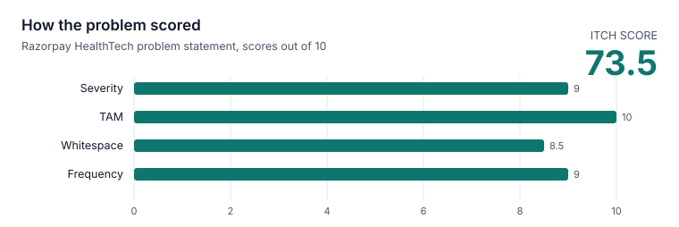

# Project overview

## Vision

Everyone can see their own medical history in one place: every report and prescription they've
ever received, readable, searchable and comparable over time, without handing judgment about
their health to software.

## Origin

The problem comes from a HealthTech problem statement published by Razorpay, *"Why can't patients
access digital copies of medical records?"*, scored Severity 9, TAM 10, Whitespace 8.5,
Frequency 9, with an **itch score of 73.5**. The statement is about hospitals not giving patients
their records digitally; Medfold reframes it around what patients already hold, the paper and
PDFs, and makes those digital, searchable and portable without needing hospitals to change.
The full story is in the [README](../../README.md#the-story).

## Problem

People collect years of medical paperwork from different labs, clinics and hospitals: PDFs in
email, printouts, photos on a phone. When a doctor asks "what was your HbA1c last year?" or "which
medicines were you prescribed in March?", the answer is buried in a folder or lost. Each lab prints
results differently, units vary, and nothing shows a value over time.

## Who it's for

One person (or a family member helping them) keeping their own records: someone managing a
long-term condition with regular blood tests, or anyone who wants their history in one place
before an appointment.

## What Medfold does

**Upload once. Find everything. Understand your medical history.**

1. **Upload** PDFs or phone photos of reports, prescriptions and summaries.
2. **Read automatically:** the text layer or OCR, then structured extraction: type, date, doctor,
   facility, lab results with units and printed ranges, medicines, and plain definitions of terms.
3. **Organise** everything on a timeline by the date of the record, not the upload.
4. **Understand over time:** each test across all reports as a chart, with values compared to the
   range printed on each report, and unit conversion for common tests.
5. **Find** anything by any word: a test, a medicine, a doctor, a hospital or text on the page.
6. **Stay in control:** correct anything that was misread, download all data, delete the account.

## Goals

1. **One upload, no typing.** A report becomes structured data without manual entry.
2. **Trustworthy.** What Medfold shows matches the document; the original is always one click
   away and anything misread can be corrected.
3. **Useful over time.** Results from different labs line up per test, across units.
4. **Private by default.** One person's data is never visible to another; the user can take
   everything out or delete it.
5. **Easy to run.** One command locally, one documented path to a production server.

## Success metrics

Each is checked by something in this repository:

| Goal | Metric | Where it's checked | Today |
|---|---|---|---|
| No typing | Sample documents fully processed without errors | CI end-to-end job (`scripts/seed-demo-data.sh`) | 8 of 8, including a phone photo |
| Trustworthy | No extraction field for diagnosis or advice; free text checked for advice wording | AI service schema and safety tests | Enforced in every build |
| Fast | p95 latency of reads under load | [Performance testing](../05-testing/performance-testing.md) | 6.5–11 ms at 20 concurrent users |
| Fast | Upload to READY for a digital PDF | Load test | 2.1 s (p95) |
| Private | Every endpoint classified; owned resources attacked by a second user | `UserIsolationTest` | All 25 routes |
| Quality | Line coverage per service | [Test plan](../05-testing/test-plan.md) | 92.6–93.5% |

## Non-goals

- **No medical advice or interpretation.** Medfold describes what documents say; it never
  diagnoses or judges a value ([ADR-007](../03-design/adr/ADR-007-ai-safety-boundary.md)).
- **Not a hospital system:** no EHR integration, no sharing with providers (yet).
- **Not multi-tenant clinical software:** each account is one person's records.

## MVP scope (v1.0)

| Area | In v1.0 |
|---|---|
| Accounts | Register, log in, sessions that survive a refresh, log out, export, delete |
| Upload | PDF/JPG/PNG up to 10 MB, drag and drop, several at once with progress, duplicate detection |
| Reading | Digital PDFs exactly; scans and photos by OCR; extraction by Claude or an offline reader |
| Records | Lab results with range comparison, medicines, explained terms, corrections |
| Insight | Timeline by record month, per-test trends with unit conversion, full-text search |
| Trust | Original shown next to extracted data; descriptive summaries only; strict privacy isolation |
| Operations | Docker, HTTPS deployment, backups, CI with end-to-end tests |

Scope boundaries for v1.0: one person per account, uploaded files only (no integrations),
English OCR, a single-server deployment. What comes next is in [ROADMAP.md](../../ROADMAP.md);
current limits in [KNOWN_LIMITATIONS.md](../../KNOWN_LIMITATIONS.md).
