# User flows

## Journey

From first visit to taking the data out.

## Document lifecycle

What the user sees as a document is read. "Waiting to process" is `UPLOADED`; the page follows
changes automatically.

## From upload to timeline, trends and search

Where each screen's data comes from.

## Screens

| Screen | Route | Purpose |
|---|---|---|
| Log in, Register | `/login`, `/register` | Start a session; return to the page originally asked for |
| Your documents | `/` | Upload, search, timeline grouped by record month |
| Document | `/documents/:id` | Original next to extracted details, results, medicines, terms; edit, reprocess, delete |
| Test results | `/labs` | Every test with its latest value |
| Trend | `/labs/:testKey` | One test over time: chart and every value with its source |
| Medicines | `/medications` | Every medicine with its source document |
| Your account | `/account` | Download data, delete account |
| System status | `/status` | Backend, database, AI service, processing |

Screenshots of each are in [`demo/screenshots`](../../demo/screenshots).
