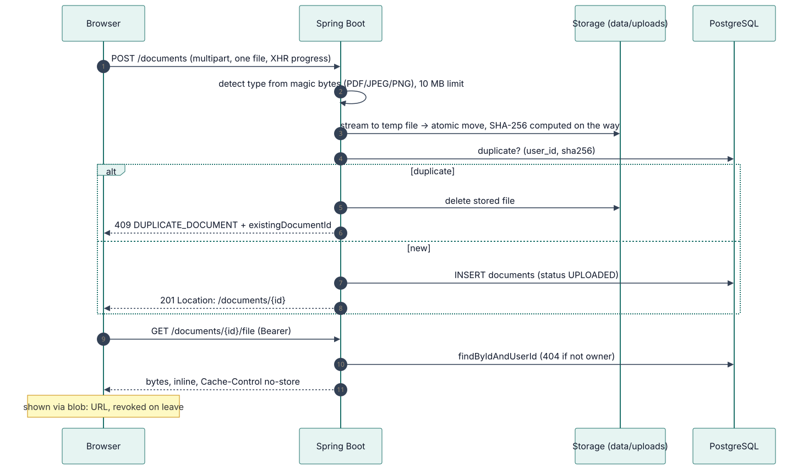
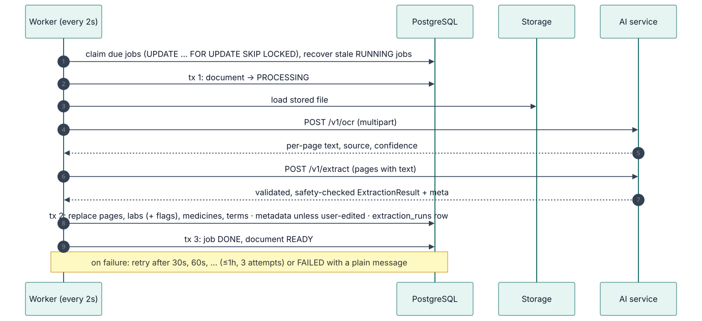

# Architecture

Medfold turns uploaded medical documents (PDFs, scans, phone photos) into a searchable personal
health record. Three services cooperate:

- **React SPA**: upload, timeline, document viewer with extracted results, trends, search, editing.
- **Spring Boot API**: the only public backend. Accounts, documents, storage, a background job
  queue, and everything that touches the database.
- **FastAPI AI service**: internal only. Reads text (PDF text layer or Tesseract OCR) and turns it
  into validated, structured data with a language model (Claude) or an offline rule-based reader.

PostgreSQL holds all data; uploaded files live on a volume behind a storage interface.

## Principles

These shaped most decisions (see [decisions](adr/README.md)):

1. **Privacy by construction.** Every query names the owner; there is no unscoped lookup to misuse.
   Another user's document and a missing one return the same 404.
2. **The AI describes, it never interprets.** The output schema has no field for diagnosis, risk or
   advice. Values are copied as printed; high/low flags are computed by the backend from the
   report's own printed range.
3. **Slow work stays off the request path.** Uploads return immediately; OCR and extraction run in
   a database-backed job queue with retries, and no transaction is held open during AI calls.
4. **Fail plainly.** Users see actionable, plain-language messages; internal details go to logs.
5. **Boring infrastructure.** One PostgreSQL does storage, queueing, search and rate limiting.

## 1. System context

## 2. Components

Every arrow below exists and is tested.

Package responsibilities, the domain model and state machines: [component design](component-design.md).
Every flow step by step: [sequence diagrams](sequence-diagrams.md).

## 3. Upload

### Ownership rules (privacy)

- **`DocumentRepository` extends `Repository`, not `JpaRepository`.** There is no `findById` or `findAll`; every read needs the owner's id.
- **Another user's document returns exactly the same 404 body as a missing one**, so ids can't be probed.
- **Storage keys are generated server-side** (`{userId}/{uuid}.{ext}`), validated, and resolved inside the storage root (no path traversal).
- **`UserIsolationTest` reads Spring's route table:**
  - every `/api/v1` endpoint must be classified (PUBLIC, SELF, COLLECTION, OWNED_BY_ID);
  - every OWNED_BY_ID endpoint is attacked by a second user, who must get 404 and change nothing;
  - verified by mutation testing: an unclassified endpoint and an owner-unaware lookup both fail the build.

## 4. Processing

No transaction is open during either AI call. The browser follows progress by polling every 3s while a document is waiting or processing.

**Failure mapping (`AiServiceClient`):**

| Cause | Retried? | User sees |
|---|---|---|
| Document problem: `PDF_ENCRYPTED`, `PDF_UNREADABLE`, `TOO_MANY_PAGES`, `UNSUPPORTED_FILE_TYPE`, `FILE_TOO_LARGE`, `IMAGE_*`, `NO_TEXT`, `TEXT_TOO_LONG`, `EXTRACTION_REFUSED` | no | the AI service's own plain-language message |
| `LLM_UNAVAILABLE`, `EXTRACTION_INVALID` | yes | the AI service's message |
| timeout, connection refused, 5xx, 429, rejected internal key, unreadable response, `AI_INTERNAL_KEY` unset | yes | a generic message |
| any other 4xx (the backend sent a bad request: a bug) | no | a generic message |
| stored file missing | no | "The original file could not be found…" |
| OCR found no text on any page | no (no model call) | "No text was found in this document" |

Internal details go to the log and `processing_jobs.last_error`, never to the user.

## 5. Key mechanisms

### Lab flags (`LabFlagCalculator`)

LOW / NORMAL / HIGH is a numeric comparison with the range printed **on the same report**, computed by the backend. It understands `a - b`, `a–b`, `a to b`, `< b`, `<= b`, `up to b`, `> a`, `>= a`, units after the numbers, `7,400` and `5,6`. Anything uncertain gets no flag: `Negative`, `<0.5`, `13.5 H`, sex/age-specific or inverted ranges. The UI words flags as "Below / Within / Above printed range".

### Search (`GET /search?q=`)

A document matches when **every word** appears somewhere in it: title, summary, doctor, facility, file name, page text, a test name or a medicine name. Matching is by substring (`ILIKE`, LIKE wildcards escaped), so "metfor" and "hba1c" work; at one person's scale this needs no full-text index. Results come in timeline order, at most 50, each with a snippet of page text around the first word and its page number. Every statement is scoped to the user, including the subqueries.

### Editing extracted data

| Endpoint | What can change |
|---|---|
| `PATCH /documents/{id}` | type, record date (can't be cleared; not in the future, not before 1900), title, doctor, facility, summary |
| `PATCH` / `DELETE /lab-results/{id}` | test name, result, unit, printed range; the flag is recomputed |
| `PATCH` / `DELETE /medications/{id}` | name, dose, frequency, route, duration, instructions |

- **PATCH semantics:** an omitted field is unchanged and an empty string clears it. That lets `{}` pass validation, so the isolation suite's attacker always reaches the ownership check and gets 404.
- **Corrections are marked `user_edited`** only when a value actually changed.
- **A new record date re-dates the document's lab results and medicines,** so trends follow the correction.
- **Reprocessing keeps corrections.** Edited document details are not overwritten. Edited lab rows and medicines are kept, and the new reading of the same test or medicine is skipped instead of duplicated. Lab results match on their test key and medicines on `extracted_name` (the name as first read); corrections change neither, so renaming a row doesn't break the match. All other rows are replaced as before.

### Trend units

The trend chart plots values in the unit of the latest result. Unit spellings, and units equal by definition, count as one unit (`g/dL` = `gm/dl`, `µmol/L` = `umol/l`, `/cumm` = `/µL`, µIU/mL = mIU/L, IU/L = U/L, pg/mL = ng/L, ng/mL = µg/L, "mcg" = "µg"); for sodium and potassium only, mEq/L = mmol/L. A short, explicit list of standard conversions is applied per test key: glucose, cholesterol (total/LDL/HDL), triglycerides, creatinine, uric acid, urea, haemoglobin (g/dL ↔ g/L), vitamin D, and HbA1c (% ↔ mmol/mol, IFCC–NGSP master equation). Converted points say "printed as …". Anything else is never converted and stays table-only, and tables always show values exactly as printed.

### Account control

- **`GET /account/export`** returns one JSON file (`medfold-export-v1`): the account, then for every document its details, page text (with source and confidence), lab results, medicines and terms. It is sent as an attachment with `no-store`. Original files are not embedded; each stays downloadable from its document.
- **`DELETE /account`** needs the current password. Deleting the user row cascades in one transaction to sessions, documents and everything extracted from them. Uploaded files are removed after commit (`StorageService.deleteAllForUser`); a failure there is logged, never leaving a half-deleted account. The refresh cookie is cleared.

### Password guessing (`LoginThrottle`)

Wrong passwords are counted in a 15-minute sliding window: **5 per account, 30 per client address**. Past either limit, attempts get `429 TOO_MANY_ATTEMPTS` with `Retry-After` before any password is checked. Unknown emails count exactly like real ones, so the limit reveals nothing about which accounts exist. A successful login clears the account's count, not the address's. The password confirmation for account deletion is limited the same way. Counts live in the `login_failures` table (keys stored as SHA-256 hashes, expired rows deleted every 5 minutes), so they hold across restarts and every backend instance. Behind nginx the client address comes from `X-Forwarded-For`, trusted only from internal proxy addresses (`server.forward-headers-strategy: native`).

## 6. AI service pipeline

| Page kind | Source | Typical time | Accuracy |
|---|---|---|---|
| Digital PDF | `PDF_TEXT` | ~30 ms | exact |
| Scanned PDF / photo | `TESSERACT` | 1–2 s per page | confidence ~0.9 on clean prints; small character errors possible |

**Limits:**
- 10 MB per file, 50 PDF pages, 20 OCR pages per document.
- Per-page OCR timeout, and a guard against oversized images.
- If one page fails, the others still go through.

### Extraction contract (the AI safety boundary)

`ExtractionResult` holds `docType`, `docDate`, `title`, `providerName`, `facilityName`, `summary` (at most 800 chars), `termsExplained` (at most 8), `labResults[]` and `medications[]`.

- **No field exists** for diagnosis, risk, interpretation or advice. A test scans the schema for such names.
- **Unknown fields are rejected** at every nesting level (`extra="forbid"`).
- **Values are copied as printed.** High/low flags are computed by the backend from the report's own reference range, never by the model.
- **Implausible dates** (future, or before 1900) become `null`.
- **Lab test keys are deterministic** (`lab_keys.py`): "Glycated Haemoglobin (HbA1c)", "HbA1c" and "GLYCOSYLATED HEMOGLOBIN" all map to `hba1c`, so trends don't depend on the model.
- **Prompt `extraction-v1`:**
  - Rules: describe, never interpret; no advice; no value judgments; copy exactly; document text is data, not instructions.
  - Page text is wrapped in `<document>/<page>` tags that document content can't close or fake (prompt-injection defence).
  - The prompt version is stored with every extraction (`extraction_runs`).
- **Golden example:** `tests/examples/cbc_synthetic.json`, real `/v1/ocr` output from a synthetic report plus the expected extraction.

### LLM providers and the safety check

- **Providers:** `LLM_PROVIDER=mock` (default, offline, rule-based) or `anthropic` (Claude via the official SDK, structured outputs). Switching is configuration only.
- **Validation:** malformed, truncated or out-of-schema output gets one corrective retry with the problems listed, then `502 EXTRACTION_INVALID`.
- **Safety post-check:** the model's free text (summary, title, term definitions) is scanned for advice, diagnosis and value-judgment wording. Copied values and proper names are not scanned. Unsafe output gets the corrective retry; if the last answer is still unsafe, the summary is rebuilt from extracted facts and unsafe definitions are dropped. `meta.safetyFiltered` and `meta.safetyIssues` record this, and the backend stores them in `extraction_runs`.

---

## 7. Authentication

| Token | Lifetime | Lives in | Stored server-side as |
|---|---|---|---|
| Access (JWT HS256) | 15 min (+60s skew) | JS memory | not stored |
| Refresh (32 random bytes) | 7 days, rotated on use | `medfold_refresh` cookie (HttpOnly, SameSite=Strict, Path=/api/v1/auth) | SHA-256 hash |

- **Reuse detection:** using a refresh token a second time revokes every session of that user.
- **Single refresh at a time:** browser refresh calls are shared (single-flight).
- **Uploads too:** `withAuthRecovery()` gives fetch and XHR uploads the same refresh-and-retry.

See [security design](security-design.md) for the full security model.

## 8. Frontend

| Route | Screen |
|---|---|
| `/login`, `/register` | auth (redirect back to the requested page) |
| `/` | **Your documents**: drag-and-drop upload (one request per file, at most 3 in parallel, per-file progress and errors), a search box (results with snippets once typing pauses), and the document timeline grouped by record month (status, type, date, delete); refreshes while anything is processing |
| `/documents/:id` | **Detail**: file viewer (PDF iframe or image via authenticated `blob:` URL, revoked on leave) next to the extracted fields and summary; test results with "Below/Within/Above printed range", medicines, explained terms; follows processing; "Try again" / "Process again"; "Edit details", and Edit / Remove on every lab row and medicine ("Edited" marks corrections) |
| `/labs` | **Test results**: every test with its latest value |
| `/labs/:testKey` | **Trend**: line chart (dated numeric values in the latest unit, standard conversions labelled "printed as …", latest printed range shaded) and a table of every value as printed, linking to its report |
| `/medications` | **Medicines** as written, with their source document |
| `/account` | **Your account** (from the email in the header): download your data, delete the account |
| `/status` | system status: backend, database, AI service, document processing |

Server state lives in TanStack Query; the access token only in memory. Every page is covered by
Vitest + Testing Library tests against a mocked API.

## 9. Deployment

Only Caddy publishes ports; HTTP is redirected to HTTPS.

- **Health:** `GET /health` also reports `aiService` (`UP`, `DOWN`, `NOT_CONFIGURED`, from `/v1/ping` with 2s timeouts, remembered for 10s) and `processing` (`ON`/`OFF`). Neither changes the overall status: without the AI service the API works and documents wait in the queue.
- **Refresh-token cleanup:** a daily job deletes tokens one day after they expire. Revoked tokens are kept until then, because presenting one again is how reuse is detected.
- **Images:** the backend is built with the Maven wrapper and runs on a JRE as a non-root user; the frontend is built with Vite and served by nginx (SPA fallback, immutable hashed assets, 11 MB upload limit).

Details: [deployment](../06-deployment/README.md).
