# Component design

## Components

How the three services and their modules connect at runtime. Backend packages are organised by
feature (`document`, `records`, `search`, …), each with its controller, service, repository and
DTOs together.

| Backend package | Responsibility |
|---|---|
| `auth` | Register, login, rotating refresh tokens, JWT validation, login throttling |
| `document` | Upload (type detection, duplicates), timeline, file streaming, corrections, reprocessing |
| `storage` | `StorageService` interface; local filesystem implementation |
| `processing` | Job queue (`FOR UPDATE SKIP LOCKED`), worker, retries, result writer |
| `ai` | HTTP client for the AI service, error mapping, availability check |
| `records` | Lab results, medicines, trends, range comparison, corrections |
| `search` | Owner-scoped search with snippets |
| `account` | Data export, account deletion |
| `common`, `config`, `health` | Error format, security and scheduling config, health endpoint |

## Domain model

The entities behind the API. Every entity below `Document` also stores `user_id`, so each query
is scoped to the owner without a join. Tables and indexes: [database](../../database/README.md).

## State machines

A **document** moves through four states; the user sees each one.

A **processing job** is retried with growing delays and recovered if a worker crashes.

State changes are methods on the entities (`Document.markProcessing()`, `ProcessingJob.fail(…)`),
which reject invalid transitions, so the rules live in one place and are unit-tested
(`DocumentTest`, `ProcessingJobTest`).

## Frontend structure

Feature folders under `src/features/` own their screens, hooks and components; `src/api/` is the
only place that talks to the backend; `src/auth/` holds the session. Server state is cached by
TanStack Query; there is no global client state beyond the session. Details:
[frontend/README.md](../../frontend/README.md).
