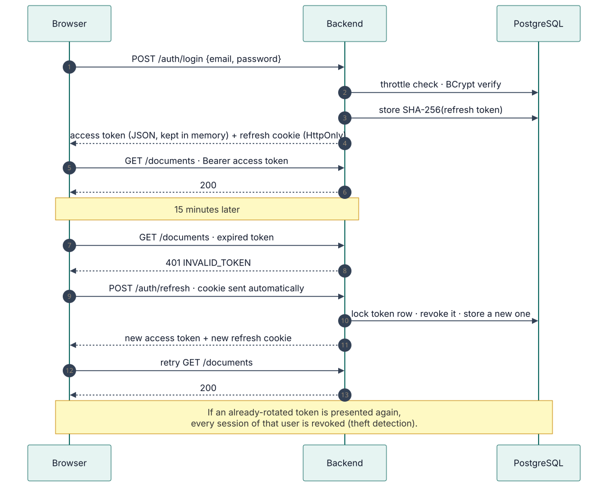
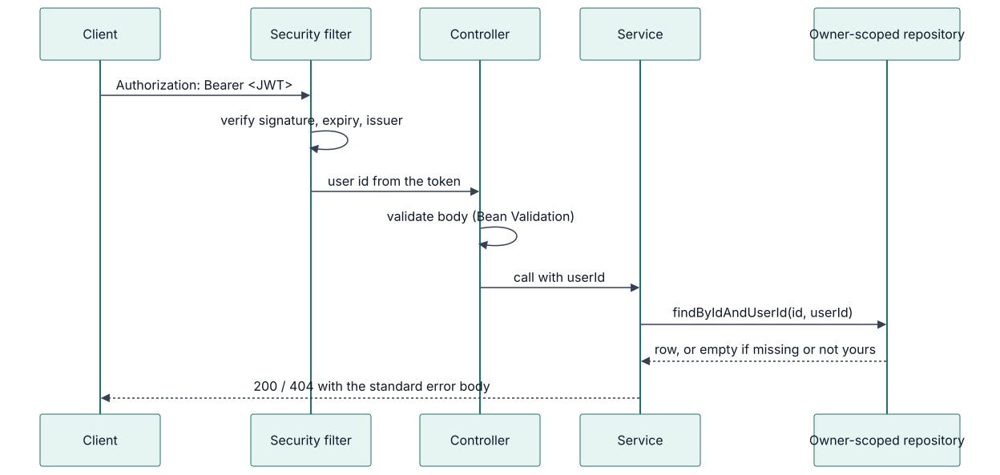
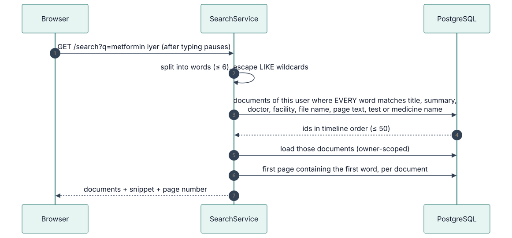
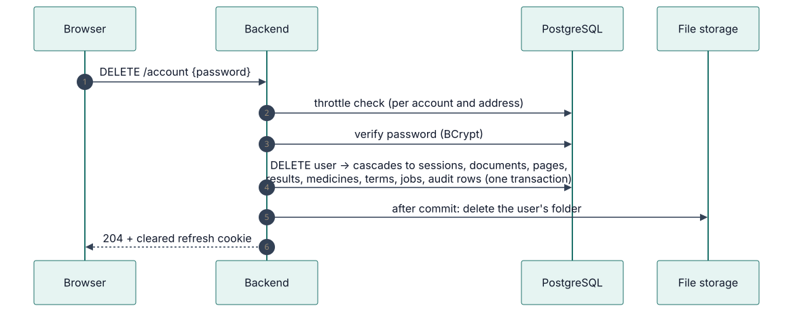

# Sequence diagrams

The main flows, step by step. Sources are in [`assets/diagrams/src`](../../assets/diagrams/src).

## Login, refresh and reuse detection

Access tokens live 15 minutes in memory; the refresh cookie rotates on every use. Details:
[ADR-001](adr/ADR-001-authentication.md).

## Upload

The file is checked, stored and queued in one request; reading happens later.

## Processing

The worker never holds a transaction during AI calls. Details:
[ADR-006](adr/ADR-006-job-queue.md).

## Authenticated request

## Search

## Account deletion

