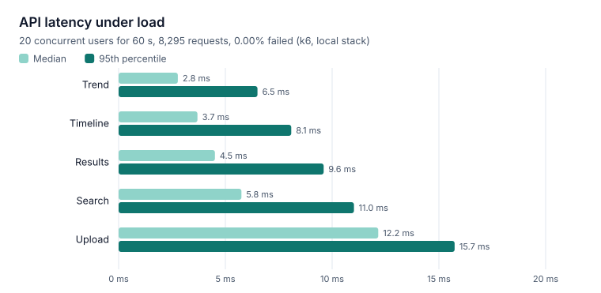

# Performance testing

## Method

[`tests/performance/load-test.js`](../../tests/performance/load-test.js) is a [k6](https://k6.io)
script with two scenarios running at the same time:

- **browse:** ramps to 20 virtual users who each, in a loop, load the timeline, a document's
  results, the HbA1c trend and a search, pausing 0.5 s between rounds (60 s).
- **upload:** one new document every 3 s (each made unique so duplicate detection doesn't reject
  it), timing from upload until it is READY.

Setup creates a fresh account and processes the six sample reports first, so reads hit real data.
Thresholds make the run fail if p95 latency or the error rate exceeds its target.

```bash
scripts/start-dev.sh   # in another terminal
docker run --rm -i --network host --user "$(id -u)" -v "$PWD/tests:/tests" grafana/k6:2.3.0 run \
  --summary-export=/tests/performance/results.json /tests/performance/load-test.js
python assets/charts/make_charts.py   # redraws the chart below from results.json
```

## Results

Local development stack in a container (backend with `spring-boot:run`, PostgreSQL in Docker,
offline reader), 2026-10-31. Raw numbers:
[`results.json`](../../tests/performance/results.json).



| Measure | Result | Threshold |
|---|---|---|
| Requests | 8,295, 0 failed | < 1% failed |
| Timeline p95 | 8.1 ms | < 200 ms |
| Results p95 | 9.6 ms | < 200 ms |
| Trend p95 | 6.5 ms | < 200 ms |
| Search p95 | 11.0 ms | < 300 ms |
| Upload p95 | 15.7 ms | < 500 ms |
| Upload → READY p95 | 2.06 s | < 10 s |

All thresholds passed. A second run gave the same numbers within a few milliseconds.

## Reading the results

- **Reads stay in single-digit milliseconds** at 20 concurrent users; the indexes on the hot paths
  ([database](../../database/README.md#indexes)) do their job at this data size.
- **Throughput (~128 requests/s) reflects the scenario's pacing,** not the server's limit: each
  user waits 0.5 s per round. This test measures latency, not capacity.
- **Upload to READY (~1.2 s median, 2.1 s p95) is dominated by the worker's 2 s polling interval;**
  the processing itself takes a fraction of that for digital PDFs with the offline reader.
- **Not covered here:** OCR of scans and Claude extraction, which depend on CPU and the model
  rather than on Medfold's code.

With real inputs, processing time is dominated by the AI service, not the API:

| Step | Typical time |
|---|---|
| PDF text layer, per page | ~30 ms |
| Tesseract OCR of a scanned page or photo | 1–2 s per page |
| Claude extraction (one call; a corrective retry doubles it) | estimated 5–30 s depending on length and model (not measured here) |

## Design choices that keep it fast

- **Asynchronous processing.** Uploads return as soon as the file is stored and the job queued
  ([ADR-006](../03-design/adr/ADR-006-job-queue.md)). The browser polls a tiny status endpoint
  every 3 s, and only while something is processing.
- **No transaction held during AI calls.** The worker commits before calling the AI service and
  writes results in a second short transaction, so slow models never block the database.
- **Text layer before OCR.** Digital PDFs skip OCR entirely ([ADR-004](../03-design/adr/ADR-004-ocr.md)).
- **Indexes for every hot path** ([database](../../database/README.md#indexes)): the timeline
  `(user_id, doc_date DESC NULLS LAST, created_at DESC)`, trends `(user_id, test_key, observed_on)`,
  the worker's claim `(status, next_run_at)`, per-document result order.
- **Streaming uploads.** Files are streamed to disk while the SHA-256 is computed, never held in
  memory; downloads are streamed with range support.
- **Bounded work.** 10 MB per file, 50 PDF pages, 20 OCR pages, a per-page OCR timeout,
  150,000 characters per extraction, page size ≤ 100 for lists, 50 search results.
- **Cheap health checks.** The AI service's availability is cached for 10 s, so status polling
  never floods it.
- **Frontend.** One production bundle with hashed assets cached for a year by nginx; server state
  cached by TanStack Query; images and PDFs shown from `blob:` URLs that are released on leave.

## Large PDFs

A 50-page scanned PDF takes about a minute of OCR. It runs in the background, the user sees
"Processing", and if the AI service is restarted mid-way the job is retried. Pages beyond the OCR
limit are recorded as pages without text rather than failing the document.

## Scaling further

| Bottleneck | Next step |
|---|---|
| One worker per backend processes jobs sequentially | Run more backend instances: the queue is safe for concurrent workers (`SKIP LOCKED`) and login throttling is shared through the database |
| OCR CPU | Run more AI service replicas behind the backend; the service is stateless |
| Search without an index | Add `pg_trgm` GIN indexes ([ADR-003](../03-design/adr/ADR-003-search.md)) |
| Local-disk file storage | An object-storage implementation of `StorageService` ([ADR-002](../03-design/adr/ADR-002-storage.md)) |
| Polling latency | Shorter poll interval, or `LISTEN/NOTIFY` to wake the worker on upload |
