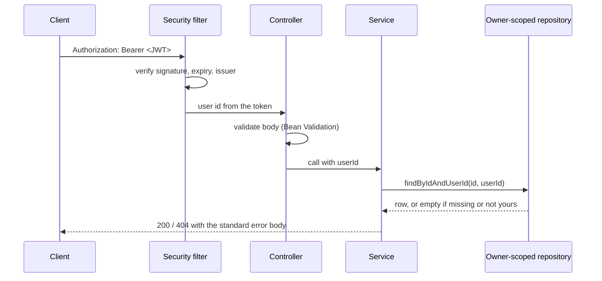

# API

REST + JSON under `/api/v1`, served by the Spring Boot backend. In the browser the SPA and the
API share one origin (Vite proxy in development, nginx in Docker), so there is no CORS.

A runnable collection of every endpoint is in [`postman/`](../../postman/README.md).

## Authentication

| Token | Lifetime | Where it lives | Server keeps |
|---|---|---|---|
| Access token (JWT, HS256) | 15 minutes | Client memory, sent as `Authorization: Bearer …` | nothing |
| Refresh token (32 random bytes) | 7 days, rotated on every use | `medfold_refresh` cookie: HttpOnly, SameSite=Strict, `Path=/api/v1/auth`, Secure in production | SHA-256 hash |

- `register` and `login` return an access token and set the refresh cookie.
- When a request answers `401 INVALID_TOKEN`, call `POST /auth/refresh` (the cookie is sent
  automatically) and retry once. The SPA does this for every request, uploads included, and
  shares one refresh between parallel requests.
- Presenting an already-rotated refresh token again revokes **every** session of that user
  (theft detection).
- Wrong passwords are limited per account and per client address; see
  [SECURITY.md](../../SECURITY.md#rate-limiting).

## Request flow



There is no endpoint that takes a user id from the client: the owner always comes from the token.

## Endpoints

Access: **public** needs no token; **self** acts on the caller's account; **collection** lists or
creates only the caller's data; **owned** addresses one resource and answers 404 to anyone but its
owner. Every route is classified this way in `UserIsolationTest`, which fails the build for an
unclassified route and attacks every *owned* route as a second user.

| Method | Path | Access | Purpose |
|---|---|---|---|
| GET | `/health` | public | Backend, database, schema version, AI service, processing on/off |
| POST | `/auth/register` | public | Create an account and start a session (201) |
| POST | `/auth/login` | public | Start a session |
| POST | `/auth/refresh` | refresh cookie | Rotate the refresh token, new access token |
| POST | `/auth/logout` | refresh cookie | Revoke the refresh token (204) |
| GET | `/auth/me` | self | Current user |
| POST | `/documents` | collection | Upload one file, multipart field `file` (201) |
| GET | `/documents?page&size` | collection | Timeline: newest record date first, undated last (`size` ≤ 100) |
| GET | `/documents/{id}` | owned | Details and extracted metadata |
| PATCH | `/documents/{id}` | owned | Correct details |
| DELETE | `/documents/{id}` | owned | Delete document, results and file (204) |
| GET | `/documents/{id}/status` | owned | Light-weight polling |
| GET | `/documents/{id}/file` | owned | Original file, inline, `no-store`, range requests |
| GET | `/documents/{id}/results` | owned | Lab results, medicines, terms in printed order |
| POST | `/documents/{id}/reprocess` | owned | Queue again (202); no-op while queued |
| PATCH | `/lab-results/{id}` | owned | Correct a lab result; the comparison is recomputed |
| DELETE | `/lab-results/{id}` | owned | Remove a wrongly read row (204) |
| PATCH | `/medications/{id}` | owned | Correct a medicine |
| DELETE | `/medications/{id}` | owned | Remove a wrongly read medicine (204) |
| GET | `/labs` | collection | Every test you have, with its latest value |
| GET | `/labs/{testKey}` | collection | One test across reports, oldest first |
| GET | `/medications` | collection | All medicines, most recently prescribed first |
| GET | `/search?q=` | collection | Documents containing every word, with snippets (≤ 50) |
| GET | `/account/export` | self | All your data as a JSON download |
| DELETE | `/account` | self | Delete the account and everything in it; body `{"password": …}` (204) |

**PATCH semantics:** a field you leave out is unchanged; an empty string clears it. Required fields
(test name, result, medicine name) can't be cleared, and the record date can be changed but not
cleared.

## Errors

Every error, in the backend and the AI service, has the same shape:

```json
{ "status": 404, "code": "DOCUMENT_NOT_FOUND", "message": "Document not found" }
```

`fields` holds per-field messages for validation errors; `details` holds data a client can act on
(the existing document id for a duplicate, `retryAfterSeconds` for rate limiting). Messages are
written for end users and never contain internal details.

| Status | Codes |
|---|---|
| 400 | `VALIDATION_ERROR` (+ `fields`), `MALFORMED_REQUEST`, `INVALID_PARAMETER`, `FILE_REQUIRED`, `FILE_UNREADABLE`, `PASSWORD_TOO_LONG`, `INVALID_DATE`, `QUERY_TOO_LONG` |
| 401 | `INVALID_TOKEN` (refresh and retry), `UNAUTHORIZED` (log in), `INVALID_CREDENTIALS`, `INVALID_REFRESH_TOKEN` |
| 403 | `WRONG_PASSWORD` (account deletion) |
| 404 | `DOCUMENT_NOT_FOUND`, `FILE_NOT_FOUND`, `LAB_RESULT_NOT_FOUND`, `LAB_TEST_NOT_FOUND`, `MEDICATION_NOT_FOUND` |
| 409 | `EMAIL_ALREADY_REGISTERED`, `DUPLICATE_DOCUMENT` (+ `details.existingDocumentId`) |
| 413 | `FILE_TOO_LARGE` (over 10 MB) |
| 415 | `UNSUPPORTED_FILE_TYPE` (only PDF, JPEG, PNG; checked from the bytes, not the name) |
| 429 | `TOO_MANY_ATTEMPTS` (+ `Retry-After`, `details.retryAfterSeconds`) |

Processing failures aren't HTTP errors: the document becomes `FAILED` with a plain
`failureReason` (e.g. "This PDF is password-protected. Remove the password and upload it again").

## Examples

```bash
API=http://localhost:8080/api/v1
```

Register and keep the access token:

```bash
TOKEN=$(curl -s -X POST $API/auth/register -H 'Content-Type: application/json' \
  -d '{"email":"you@example.com","password":"a long password"}' | python3 -c 'import json,sys; print(json.load(sys.stdin)["accessToken"])')
```

Upload a report and watch it being processed:

```bash
ID=$(curl -s -X POST $API/documents -H "Authorization: Bearer $TOKEN" \
  -F file=@tests/fixtures/reports/complete-blood-count-2026-03-02.pdf | python3 -c 'import json,sys; print(json.load(sys.stdin)["id"])')
curl -s $API/documents/$ID/status -H "Authorization: Bearer $TOKEN"
```

```json
{ "id": "8d0e…", "status": "READY", "failureReason": null }
```

Read the extracted results:

```bash
curl -s $API/documents/$ID/results -H "Authorization: Bearer $TOKEN"
```

```json
{
  "labResults": [
    {
      "testName": "Haemoglobin", "testKey": "haemoglobin",
      "valueText": "11.4", "valueNumeric": 11.4, "unit": "g/dL",
      "refText": "12.0 - 15.5", "refLow": 12.0, "refHigh": 15.5,
      "flag": "LOW", "observedOn": "2026-03-02", "pageNumber": 1, "userEdited": false
    }
  ],
  "medications": [],
  "terms": [{ "term": "CBC", "definition": "A Complete Blood Count is a common blood test…" }]
}
```

Correct a value and search:

```bash
curl -s -X PATCH $API/lab-results/<labResultId> -H "Authorization: Bearer $TOKEN" \
  -H 'Content-Type: application/json' -d '{"valueText":"11.8"}'
curl -s "$API/search?q=haemoglobin" -H "Authorization: Bearer $TOKEN"
```

## Internal AI service API

Reachable only from the backend, authenticated with `X-Internal-Api-Key`. Interactive docs at
`http://localhost:8000/docs` in development.

| Method | Path | Purpose |
|---|---|---|
| GET | `/health` | OCR provider, languages, Tesseract version, LLM provider |
| GET | `/v1/ping` | Checks the internal key (used by the backend's health check) |
| POST | `/v1/ocr` | Per-page text with source (`PDF_TEXT`, `TESSERACT`, `NONE`) and confidence |
| POST | `/v1/extract` | Validated, safety-checked structured data from page texts |
