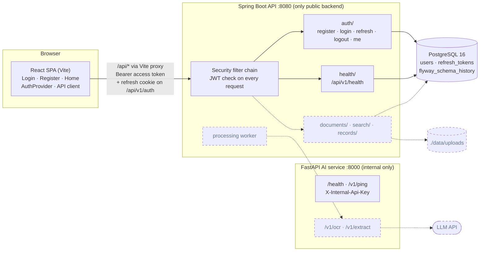
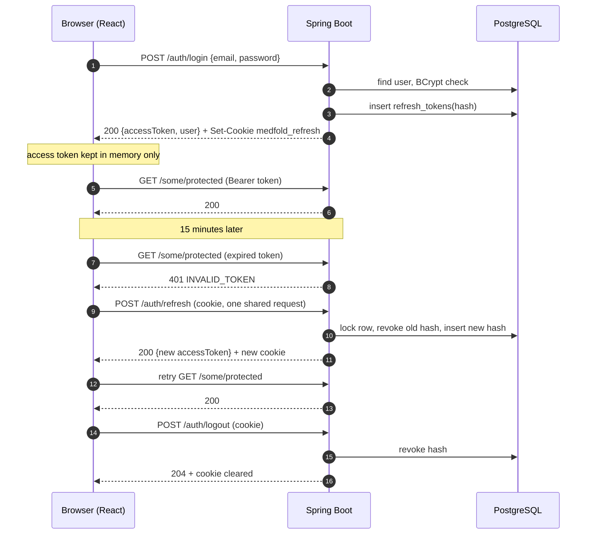

# Medfold architecture

Living document, updated at every 10-task checkpoint.

**Current checkpoint:** Tasks 1–10 complete (Phase 0 setup, Phase 1 authentication).
**Next checkpoint:** after Task 20 (documents upload + AI service OCR/extraction).

---

## 1. System overview

Solid boxes and arrows exist and are tested. Dashed ones are planned.

### What runs where (local development)

| Component | How to start | Port | Talks to |
|---|---|---|---|
| PostgreSQL 16 | `docker compose up -d db` | 5432 | — |
| Spring Boot API | `cd backend && ./mvnw spring-boot:run` | 8080 | PostgreSQL |
| FastAPI AI service | `docker compose up -d --build ai-service` | 8000 | nothing yet (wired up in Task 25) |
| React SPA | `cd frontend && npm run dev` | 5173 | Spring Boot, through the Vite `/api` proxy |

All configuration comes from the repo-root `.env` (template: `.env.example`).

---

## 2. Authentication design

### Tokens

| Token | Lifetime | Where it lives | Where it's sent | Stored server-side as |
|---|---|---|---|---|
| Access token (JWT, HS256) | 15 min (+60s clock-skew allowance) | JavaScript memory only | `Authorization: Bearer` on API calls | not stored (stateless) |
| Refresh token (32 random bytes) | 7 days | `medfold_refresh` cookie: HttpOnly, Secure, SameSite=Strict | only to `/api/v1/auth/*` | SHA-256 hash in `refresh_tokens` |

### Login → expiry → refresh → logout

### Security rules in place

- Passwords are hashed with BCrypt. Passwords over 72 bytes are rejected rather than silently truncated.
- Unknown email and wrong password return the same `401 INVALID_CREDENTIALS`, with similar timing.
- If a refresh token is reused after rotation, every session of that user is revoked (theft detection).
- Refresh is single-flight in the browser, so parallel requests or React StrictMode never trigger reuse detection by accident.
- Public endpoints ignore the `Authorization` header, so a stale token can't block login or health.
- `@CurrentUserId UUID` gives controllers the caller's id. Every user-owned query must be scoped by it.
- The app refuses to start without `JWT_SECRET` (min 32 chars).
- The AI service rejects every `/v1/*` call when `AI_INTERNAL_KEY` is missing or wrong.

### 401 codes the frontend relies on

| Code | Meaning | Frontend reaction |
|---|---|---|
| `UNAUTHORIZED` | no token, or the user no longer exists | go to login |
| `INVALID_TOKEN` | bad or expired access token | refresh once, retry |
| `INVALID_REFRESH_TOKEN` | refresh cookie missing, expired, revoked or reused | go to login with "session expired" |
| `INVALID_CREDENTIALS` | wrong email or password | show message on login form |

---

## 3. Database (Flyway)

| Version | Tables |
|---|---|
| V1 `baseline` | — |
| V2 `users_and_auth` | `users` (unique lowercase email), `refresh_tokens` (hash, expiry, revoked_at; cascade on user delete) |

Hibernate runs with `ddl-auto: validate`: Flyway owns the schema and Hibernate only checks it.

---

## 4. API (current)

| Method | Path | Auth | Purpose |
|---|---|---|---|
| GET | `/api/v1/health` | public | backend + database status, schema version |
| GET | `/actuator/health` | public | Spring health |
| POST | `/api/v1/auth/register` | public | create account, start session (201) |
| POST | `/api/v1/auth/login` | public | start session |
| POST | `/api/v1/auth/refresh` | refresh cookie | rotate refresh token, new access token |
| POST | `/api/v1/auth/logout` | refresh cookie | revoke, clear cookie (204) |
| GET | `/api/v1/auth/me` | Bearer | current user |
| GET | `ai-service /health` | public (internal network) | OCR provider, Tesseract version |
| GET | `ai-service /v1/ping` | `X-Internal-Api-Key` | backend ↔ AI key check |

Every error uses one shape: `{status, code, message, fields?}`.

---

## 5. Tests

| Module | Command | Tests |
|---|---|---|
| backend | `./mvnw test` (needs Docker for Testcontainers) | 43 |
| ai-service | `pytest` | 5 |
| frontend | `npm test` | 21 |

---

## 6. Task log

| # | Task | Commit |
|---|---|---|
| 1 | Monorepo + PostgreSQL in Docker Compose | `57c6989` |
| 2 | Spring Boot + health + Flyway | `12e8a66` |
| 3 | FastAPI + Tesseract image + internal key | `1212e06` |
| 4 | React + Tailwind + router + status card | `083c5e0` |
| 5 | users / refresh_tokens schema + entities | `98625ef` |
| 6 | Register + login, BCrypt, JWT | `236cb51` |
| 7 | JWT validation on every request + `/auth/me` | `9143dfa` |
| 8 | Rotating refresh tokens + logout | `3a0b47c` |
| 9 | React login/register, session restore, protected routes | `4251ec5` |
| 10 | Auto-refresh and retry on expired tokens | `1b0d788` |

## 7. Known limitations (accepted for now)

- Expired and revoked refresh-token rows are never cleaned up. Planned: a nightly job.
- Two browser tabs refreshing at exactly the same moment can trigger reuse detection and log the user out.
- The backend and frontend are not in Docker Compose yet. They run with `./mvnw` and `npm`.
- No CORS configuration: in development the Vite proxy makes everything same-origin. It's needed before deployment.
- The AI service Docker image couldn't be built in the cloud dev sandbox (Debian mirror blocked there); it builds on a normal machine.
